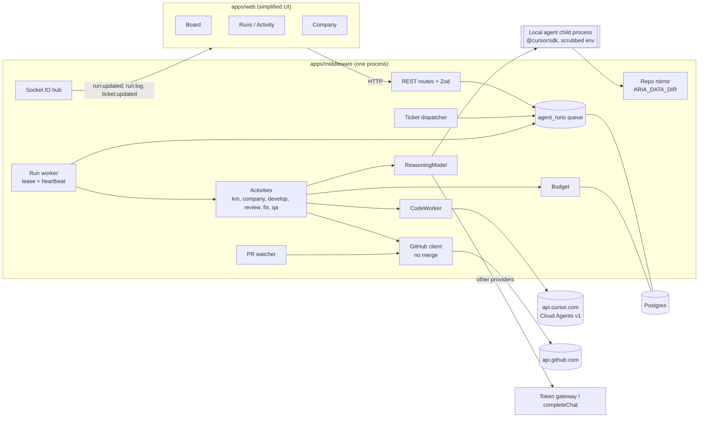
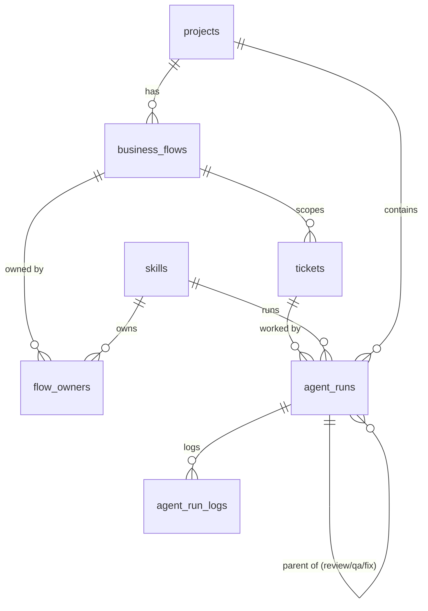
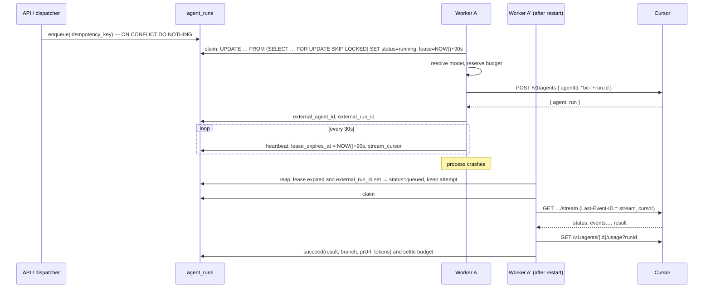
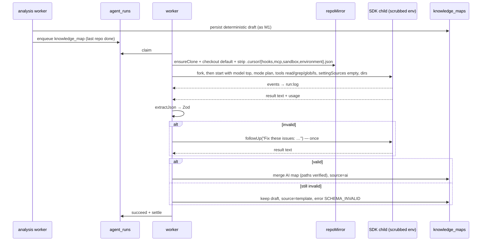
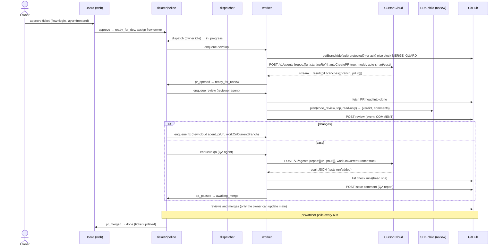
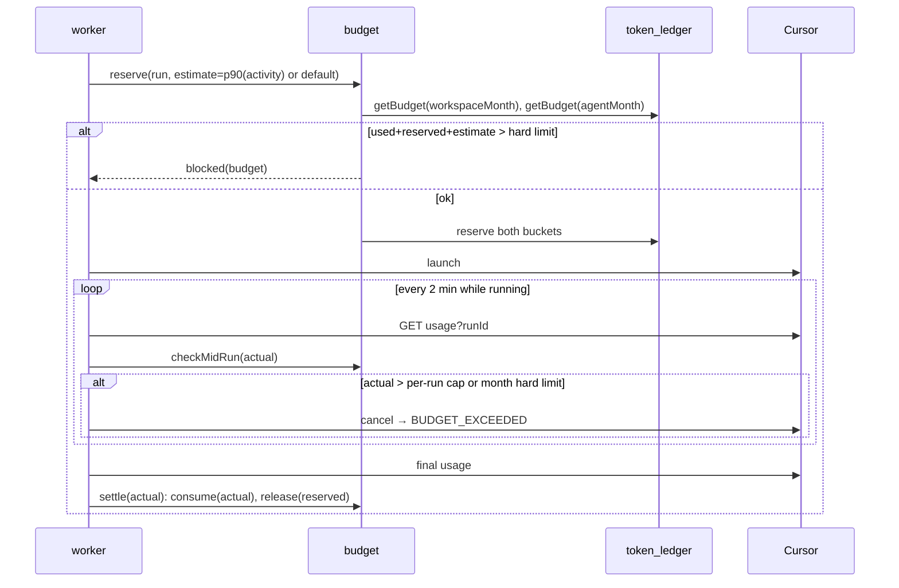

# Milestone 2 — Agents doing real work through Cursor

Status: backend implemented on `cursor/m2-backend-1c0c`. What landed, and what is still open, is in `PROGRESS.md`. Author: lead architect, 2026-10-25.
Inputs: `docs/PRODUCT_SPEC.md` (wins on conflict), `docs/CURSOR_PROVIDER.md`, `PROGRESS.md` (Milestone 1 merged as #5).

M2 turns the M1 company into one that works. When an approved ticket belongs to a flow, the flow's owner agent picks it up, Cursor writes the code on a branch and opens a PR, then a peer reviewer agent and a QA agent run against that PR. The ticket moves across the board live, and the owner merges. ARIA never merges. The knowledge map and the company are generated by Cursor planning runs instead of templates.

---

## 0. Key decisions (read this if nothing else)

| # | Decision | Why |
|---|---|---|
| D1 | One table, `agent_runs`, is the durable queue for every AI activity. That covers knowledge map, company generation, develop, review, fix, and QA. Workers claim runs by lease with `FOR UPDATE SKIP LOCKED`, heartbeat every 30 s, and a reaper reclaims expired leases. | It is the same pattern as `analysis_jobs` in M1, made general. Postgres is already the source of truth, and nothing new needs to be operated. |
| D2 | The model layer splits into `ReasoningModel` (planning: structured JSON, read-only) and `CodeWorker` (start, stream or poll, result, branch, PR URL, usage, cancel). | Planning is a short call that returns validated data. Coding is a long external job with git side effects. One interface for both is what made M1 throw `CURSOR_NO_CHAT_API`. |
| D3 | Planning on Cursor uses **`@cursor/sdk` local runs** in a **child process**. The run uses `mode: "plan"`, `tools: ["read","grep","glob","ls"]` (company generation uses `tools: []`), `local.settingSources: []`, an isolated `HOME`, and a scrubbed env. It runs against an ARIA-owned clone outside the user's working copy. | The SDK is the only Cursor surface that runs against a local tree with a tool allowlist. Running it in a child process keeps the middleware's secrets (`DATABASE_URL`, JWT keys, `WORKSPACE_ENCRYPTION_KEY`) out of the agent's process env. |
| D4 | Coding on Cursor uses the **Cloud Agents REST API v1**, called with `fetch` and not the SDK. The request sets `autoCreatePR: true` and a client-supplied `agentId = "bc-" + agent_runs.id` so creates are idempotent. Progress comes from SSE with `Last-Event-ID` resume, falling back to polling `GET /runs/{runId}` on `410`. The PR URL comes from `git.branches[].prUrl`. | REST is what M1 already calls and can be stubbed through `CURSOR_API_BASE`, so CI needs no keys. The SDK cloud runtime has no documented base-URL override. |
| D5 | **Agents cannot merge, by permission rather than by prompt.** ARIA's GitHub token is a fine-grained PAT with **Contents: read** and **Pull requests: read/write**, and no Contents write, so it cannot merge or push. The GitHub client also refuses any merge endpoint in code (a tripwire). A GitHub **ruleset** on the default branch (restrict updates to the owner, require a PR, block force-push) stops the Cursor GitHub App from merging. ARIA checks that the branch is protected before it launches any coding run. | REST v1 has no `openAsCursorGithubApp`, so with a user API key PRs are authored by the owner. A rule that requires approvals would then block the owner from approving their own PR, so the guard is "restrict updates", not "require approvals". |
| D6 | ARIA posts reviews only as `event: "COMMENT"`. The type literally does not allow `APPROVE` or `REQUEST_CHANGES`. | The PAT acts as the owner. An `APPROVE` from it would counterfeit the owner's approval. |
| D7 | Flow ownership has one source of truth, the `flow_owners(flow_id, agent_id, layer, role)` join table, with layer `frontend`/`backend`/`fullstack` and role `owner`/`backup`. `business_flows.owner_agent_id`, `business_flows.backup_agent_id`, and `skills.owned_flow_ids` are backfilled and then **dropped** (Java maps none of them). | Ownership is currently stored in two places that can drift. |
| D8 | Budget: before launch, reserve an estimate in the existing `token_ledger`, using **monthly buckets** (`uuidv5(workspaceId:YYYY-MM)` and `uuidv5(agentId:YYYY-MM)`). Mid-run, poll usage and cancel when the per-run cap or the monthly hard limit is crossed. At the end, settle with the actual usage Cursor reports. Estimates self-calibrate to the p90 of the last 20 runs of each activity. | This reuses M1's ledger and needs no new budget table. |
| D9 | Model ids are resolved at **claim** time and validated against the stored `GET /v1/models` catalog, which is refreshed every 24 h. Planning uses the top tier (catalog pick). Development uses `auto-smart` with `optimize_for=cost` when the catalog lists it, otherwise `{ id: "auto" }`. This flips M1's Auto preference order to match the spec. | This follows the model tiering in the product spec, and late binding survives catalog changes. |
| D10 | Peer review is a planning run: local, read-only, top tier, task type `code_review`, against the PR head in the ARIA clone. QA is a cloud coding run attached to the PR (`repos[0].prUrl`, `workOnCurrentBranch: true`, task `tests`, Auto) that runs the tests, adds missing ones, and reports JSON. Fix runs are **new** cloud agents attached to the PR rather than follow-ups on the original agent. | Starting each run fresh on the PR head avoids non-fast-forward conflicts after QA has pushed tests. |
| D11 | The fallback local worktree worker is opt-in. It requires a second token, a "push token" with Contents write, plus a host where the SDK sandbox works. ARIA falls back automatically only on `IntegrationNotConnected` (Cursor cannot see the repo), never on generic errors. | Falling back on generic errors risks paying twice and widens permissions silently. |
| D12 | Frontend M2 work starts **after the UI simplification PR merges**. It uses that PR's sidebar (Projects, Company, Board, Runs/Activity, Settings) and its primitives, and adds at most two primitives (`LogView`, `RunStatusBadge`). Backend tasks B1–B18 do not depend on it. | This was a direct instruction from the owner. |

Non-goals for M2 are the standup ceremony itself, the merge-order coordinator, red and blue team execution, the idea and proposal pipeline, the learning agent, a visual-regression suite, an LLM security-review stage, worker sub-agents under flow owners, multi-tenant, and GitHub webhooks (ARIA is local-first with no public URL, so it polls). Before/after screenshot capture for the evidence reports in §17 is in M2. The broader visual-regression suite stays M3. Schedule alerts go to the scrum master and the owner; the ceremony stays later.

---

## 1. Cursor surface verified for this plan (October 2026)

Sources: [Cloud Agents API endpoints](https://cursor.com/docs/cloud-agent/api/endpoints), [OpenAPI](https://cursor.com/docs-static/cloud-agents-openapi.yaml), [TypeScript SDK](https://cursor.com/docs/sdk/typescript), `@cursor/sdk` 1.0.40 on npm.

| Fact | Used for |
|---|---|
| `POST /v1/agents` takes `{ prompt.text, model{id,params}, name, agentId, repos[{url, startingRef, prUrl}], workOnCurrentBranch, autoCreatePR, skipReviewerRequest, mode: agent\|plan, envVars, mcpServers, customSubagents }` and returns `{ agent, run }`. | Develop, fix, and QA launches. |
| A client `agentId` (`bc-<uuid>`) re-POST returns `409 agent_id_conflict`. It cannot be combined with `envVars`. | Idempotent create after a crash. ARIA never sends `envVars`. |
| The REST `CreateAgentRequest` has **no** `openAsCursorGithubApp`. That option exists only on the SDK `CloudAgentOptions` (default `false` for user keys). | With a user key, PRs are opened as the owner. See D5. |
| `GET /v1/agents/{id}/runs/{runId}` reports status `CREATING\|RUNNING\|WAITING_FOR_BACKGROUND_WORK\|FINISHED\|ERROR\|CANCELLED\|EXPIRED`, plus `result`, `durationMs`, and `git.branches[{repoUrl, branch, prUrl}]`. `git` is per agent, not per run, and `repoUrl` has no scheme. | PR capture. Strip the scheme before matching the repo. |
| `GET …/runs/{runId}/stream` is SSE with events `status`, `assistant`, `thinking`, `tool_call`, `heartbeat`, `result`, `error`, and `done`. Resume with `Last-Event-ID`. It returns `410 stream_expired` after the retention window. | Live logs and resume. |
| `POST …/runs/{runId}/cancel` returns `409 run_not_cancellable` when the run is terminal. | Budget and agent-off cancellation. |
| `GET /v1/agents/{id}/usage?runId=` returns `{ inputTokens, outputTokens, cacheWriteTokens, cacheReadTokens, totalTokens }`. | Settling the reservation. |
| `GET /v1/models` returns `items[{id, displayName, aliases, parameters, variants}]`. | Tier resolution (M1 already parses this). |
| The SDK (`Agent.create({ local: { cwd, dirs, settingSources, sandboxOptions } , tools, disallowedTools, mode, model })`) has `tools` and `disallowedTools` for **local only**. `tools: []` means text only. Without `settingSources`, only inline MCP servers load. `run.wait()` returns `{ status, result, usage, durationMs }`. Errors extend `CursorSdkError` with `isRetryable`. It needs **Node ≥ 22.13**. | Planning runs. CI must move from Node 20 to Node 22. |
| Hooks are file-based (`.cursor/hooks.json`, `~/.cursor/hooks.json`). The docs do not say whether `settingSources: []` disables project hooks. The workspace scan always reads rules and `AGENTS.md`. | ARIA deletes `.cursor/{hooks,mcp,sandbox,environment}.json` from its clone and sets `HOME` to an ARIA directory. Task B8 verifies this live. |
| Cloud runs always load project, team, and plugin config, and ignore `settingSources`. | Cloud agents will run the user's own repo hooks. That is acceptable, since it is the user's repo. |
| There is no JSON or structured-output mode on either surface. | ARIA asks for a fenced JSON block, validates it with Zod, and retries once. |

---

## 2. Architecture



All of this runs in the middleware process. Java is unchanged in M2, and none of the tables M2 touches are mapped by Hibernate (verified: `skills`, `tickets`, `business_flows`, and `knowledge_maps` have no `@Table`).

---

## 3. Data model and migrations

Flyway stays the source of truth, and Drizzle mirrors it. `scripts/check-schema-drift.cjs` gains checks for the new tables and the dropped columns.

### V15 — `V15__agent_runs.sql`

```sql
CREATE TABLE IF NOT EXISTS agent_runs (
  id                 UUID PRIMARY KEY DEFAULT uuid_generate_v4(),
  workspace_id       UUID NOT NULL REFERENCES workspaces(id) ON DELETE CASCADE,
  project_id         UUID NOT NULL REFERENCES projects(id)   ON DELETE CASCADE,
  agent_id           UUID REFERENCES skills(id)  ON DELETE SET NULL,   -- null = system run
  ticket_id          UUID REFERENCES tickets(id) ON DELETE SET NULL,
  parent_run_id      UUID REFERENCES agent_runs(id) ON DELETE SET NULL,
  activity           TEXT NOT NULL CHECK (activity IN
                       ('knowledge_map','company_generation','develop','review','fix','qa')),
  task_type          TEXT NOT NULL,              -- modelTiers TaskType
  runtime            TEXT NOT NULL CHECK (runtime IN
                       ('cursor_local','cursor_cloud','local_worktree','chat')),
  status             TEXT NOT NULL DEFAULT 'queued' CHECK (status IN
                       ('queued','running','blocked','succeeded','failed','cancelled')),
  blocked_reason     TEXT,                       -- budget | agent_off | merge_guard | repo_access | key_invalid
  priority           INTEGER NOT NULL DEFAULT 0,
  idempotency_key    TEXT NOT NULL UNIQUE,       -- e.g. ticket:<id>:develop:1
  attempt            INTEGER NOT NULL DEFAULT 0,
  max_attempts       INTEGER NOT NULL DEFAULT 3,
  not_before         TIMESTAMPTZ NOT NULL DEFAULT NOW(),
  lease_owner        TEXT,
  lease_expires_at   TIMESTAMPTZ,
  heartbeat_at       TIMESTAMPTZ,
  model_id           TEXT,
  model_params       JSONB NOT NULL DEFAULT '[]'::jsonb,
  external_agent_id  TEXT,                       -- bc-… (cloud) / agent-… (local)
  external_run_id    TEXT,                       -- run-…
  external_url       TEXT,
  stream_cursor      TEXT,                       -- last SSE id
  repo_id            UUID REFERENCES project_repos(id) ON DELETE SET NULL,
  base_ref           TEXT,
  head_sha           TEXT,
  branch             TEXT,
  pr_url             TEXT,
  pr_number          INTEGER,
  input              JSONB NOT NULL DEFAULT '{}'::jsonb,   -- structured activity input
  prompt_text        TEXT,                                 -- exact text sent (audit)
  result_text        TEXT,
  result_json        JSONB,
  output_source      TEXT CHECK (output_source IN ('ai','template')),
  error_code         TEXT,
  error_message      TEXT,
  tokens_reserved    BIGINT NOT NULL DEFAULT 0,
  tokens_input       BIGINT, tokens_output BIGINT,
  tokens_cache_read  BIGINT, tokens_cache_write BIGINT,
  tokens_total       BIGINT,
  created_at         TIMESTAMPTZ NOT NULL DEFAULT NOW(),
  started_at         TIMESTAMPTZ,
  finished_at        TIMESTAMPTZ,
  updated_at         TIMESTAMPTZ NOT NULL DEFAULT NOW()
);
CREATE INDEX IF NOT EXISTS idx_agent_runs_claim   ON agent_runs(status, not_before, priority DESC, created_at);
CREATE INDEX IF NOT EXISTS idx_agent_runs_project ON agent_runs(project_id, created_at DESC);
CREATE INDEX IF NOT EXISTS idx_agent_runs_ticket  ON agent_runs(ticket_id);
CREATE INDEX IF NOT EXISTS idx_agent_runs_lease   ON agent_runs(lease_expires_at) WHERE status = 'running';
-- "One task at a time per agent" backstop. Claim also checks it.
CREATE UNIQUE INDEX IF NOT EXISTS uq_agent_runs_one_running
  ON agent_runs(agent_id) WHERE status = 'running' AND agent_id IS NOT NULL;

CREATE TABLE IF NOT EXISTS agent_run_logs (
  id          BIGSERIAL PRIMARY KEY,
  run_id      UUID NOT NULL REFERENCES agent_runs(id) ON DELETE CASCADE,
  seq         INTEGER NOT NULL,
  kind        TEXT NOT NULL CHECK (kind IN ('status','assistant','tool','system','error')),
  message     TEXT NOT NULL,                 -- redacted, <= 4000 chars
  created_at  TIMESTAMPTZ NOT NULL DEFAULT NOW(),
  UNIQUE (run_id, seq)
);

ALTER TABLE knowledge_maps
  ADD COLUMN IF NOT EXISTS source TEXT NOT NULL DEFAULT 'template',
  ADD COLUMN IF NOT EXISTS agent_run_id UUID REFERENCES agent_runs(id) ON DELETE SET NULL;
ALTER TABLE business_flows
  ADD COLUMN IF NOT EXISTS layer TEXT NOT NULL DEFAULT 'fullstack';   -- AI-suggested layer
ALTER TABLE workspaces
  ADD COLUMN IF NOT EXISTS llm_catalog_refreshed_at TIMESTAMPTZ,
  ADD COLUMN IF NOT EXISTS github_push_token_encrypted TEXT;          -- optional, D11
ALTER TABLE projects
  ADD COLUMN IF NOT EXISTS company_source TEXT NOT NULL DEFAULT 'template',
  ADD COLUMN IF NOT EXISTS company_run_id UUID REFERENCES agent_runs(id) ON DELETE SET NULL,
  ADD COLUMN IF NOT EXISTS code_runtime TEXT NOT NULL DEFAULT 'cursor_cloud',   -- or local_worktree
  ADD COLUMN IF NOT EXISTS token_budget_monthly BIGINT,                         -- null = env default
  ADD COLUMN IF NOT EXISTS merge_guard_ack_at TIMESTAMPTZ;                      -- owner accepted unprotected branch
ALTER TABLE skills
  ADD COLUMN IF NOT EXISTS token_budget_monthly BIGINT;
ALTER TABLE tickets
  ADD COLUMN IF NOT EXISTS status_reason TEXT;
```

`tickets.status` is `TEXT` in Postgres (the Drizzle `pgEnum` is TypeScript-only). M2 adds two values, `awaiting_merge` and `blocked`, to `@aria/shared` `TicketStatus`, the Drizzle enum list, and the Zod schemas. `ready_for_qa` stays for compatibility with the protected sprint 4 specs, and the new pipeline does not use it.

### V16 — `V16__flow_owners.sql` (lands with task B10, in the same commit as the code switch)

```sql
CREATE TABLE IF NOT EXISTS flow_owners (
  flow_id    UUID NOT NULL REFERENCES business_flows(id) ON DELETE CASCADE,
  agent_id   UUID NOT NULL REFERENCES skills(id)         ON DELETE CASCADE,
  layer      TEXT NOT NULL CHECK (layer IN ('frontend','backend','fullstack')),
  role       TEXT NOT NULL CHECK (role IN ('owner','backup')),
  created_at TIMESTAMPTZ NOT NULL DEFAULT NOW(),
  PRIMARY KEY (flow_id, layer, role)
);
CREATE INDEX IF NOT EXISTS idx_flow_owners_agent ON flow_owners(agent_id);

INSERT INTO flow_owners (flow_id, agent_id, layer, role)
SELECT f.id, f.owner_agent_id,
       CASE s.role_key WHEN 'frontend' THEN 'frontend' WHEN 'backend' THEN 'backend' ELSE 'fullstack' END,
       'owner'
  FROM business_flows f JOIN skills s ON s.id = f.owner_agent_id
ON CONFLICT DO NOTHING;
INSERT INTO flow_owners (flow_id, agent_id, layer, role)
SELECT f.id, f.backup_agent_id, o.layer, 'backup'
  FROM business_flows f JOIN flow_owners o ON o.flow_id = f.id AND o.role = 'owner'
 WHERE f.backup_agent_id IS NOT NULL
ON CONFLICT DO NOTHING;

ALTER TABLE business_flows DROP COLUMN IF EXISTS owner_agent_id, DROP COLUMN IF EXISTS backup_agent_id;
ALTER TABLE skills DROP COLUMN IF EXISTS owned_flow_ids;

ALTER TABLE tickets
  ADD COLUMN IF NOT EXISTS flow_id UUID REFERENCES business_flows(id) ON DELETE SET NULL,
  ADD COLUMN IF NOT EXISTS layer TEXT CHECK (layer IN ('frontend','backend','fullstack'));
```

The service enforces one invariant the PK cannot express: a flow has either a `fullstack` owner, or `frontend` and/or `backend` owners, never both. Deleting an agent promotes its backup first, which is the M1 behavior moved into `flowOwners.removeAgent`, and then cascades.

### Entity relationships



---

## 4. Module boundaries (apps/middleware/src)

New code lives in a few sub-folders under `services/`. Controllers stay thin and nothing calls Cursor or GitHub from a controller.

| Module | Responsibility | Depends on |
|---|---|---|
| `services/runs/runQueue.ts` | `enqueue` (idempotent on key), `claim(workerId, runtimes[])`, `heartbeat`, `succeed`, `fail(retryable)`, `block(reason)`, `cancel`, `reap()`. SQL on the pg pool. Time is always DB `NOW()`. | pg |
| `services/runs/runWorker.ts` | Loop with per-runtime concurrency (`cursor_local` 1, `cursor_cloud` 3, `local_worktree` 1, `chat` 2). Dispatches by `activity` to a handler. Heartbeat timer per run. Graceful stop on SIGTERM releases leases. | runQueue, activities |
| `services/runs/runLogs.ts` | `append(runId, kind, text)` with redaction (Cursor key, GitHub tokens, generic secret patterns) and coalescing (assistant deltas flushed per line or every 2 s). Caps at 2000 lines per run, after which only status and error lines are kept. `list(runId, afterSeq)`. Emits `run:log`. | ws hub |
| `services/runs/budget.ts` | `reserve(run)`, `checkMidRun(run, usage)`, `settle(run, usage)`, `estimateFor(activity)` (p90 of the last 20, else default). Uses the existing `PgTokenLedgerRepository` with monthly bucket UUIDs. | ledger.repository |
| `services/models/reasoning.ts` | `ReasoningModel` interface plus `reasoningFor(workspace)` factory. | — |
| `services/models/structuredOutput.ts` | `extractJson(text)` (last fenced json block, else last balanced `{…}`), then `parseWithRetry(schema, first, retryFn)` with exactly one retry carrying Zod issues. | zod |
| `services/models/cursorLocalReasoner.ts` | Planning via the child process (below). Builds options from D3. | localAgentProcess, repoMirror |
| `services/models/localAgentProcess.ts` + `localAgentChild.ts` | `fork()`s a child with env `{PATH, HOME=$ARIA_DATA_DIR/cursor-home, LANG, CURSOR_API_KEY}` only. Talks over IPC: `start`, `event`, `followUp`, `cancel`, `result`. Has a wall-clock timeout and kills on overrun. In stub mode the child reads fixtures. | @cursor/sdk |
| `services/models/chatReasoner.ts` | The same `ReasoningModel` for Gemini, Groq, OpenAI, Anthropic, Ollama, and compatible providers, through `completeThroughGateway`. | guardedLlm |
| `services/models/codeWorker.ts` | `CodeWorker` interface plus `codeWorkerFor(project)` factory. | — |
| `services/models/cursorCloudWorker.ts` | REST v1: create (idempotent), stream with resume, poll, usage, cancel. Maps events to logs. | fetch, runLogs |
| `services/models/localWorktreeWorker.ts` | D11 fallback. SDK local in agent mode in a `git worktree`, with sandbox required. ARIA pushes with the push token and opens the PR. | localAgentProcess, repoMirror, githubClient |
| `services/repos/repoMirror.ts` | `ensureClone(repo)` (`--filter=blob:none` into `$ARIA_DATA_DIR/repos/<projectId>/<repoId>`), `checkout(ref|sha)` with `clean -fdx`, `fetchPr(n)`, `diff(base, head, capBytes)`, `worktree(branch)`, `strip()` (deletes `.cursor/{hooks,mcp,sandbox,environment}.json`), `pathExists`. The token reaches git only through a one-shot `GIT_ASKPASS` script env and is never written to the URL or `.git/config`. | child_process git |
| `services/github/githubClient.service.ts` (extend) | `getPull`, `createPull`, `createReview({event:'COMMENT'})`, `createIssueComment`, `listCheckRuns(sha)`, `getBranch` (`protected`). `request()` throws `MERGE_FORBIDDEN` for any `/pulls/\d+/merge`, `/merges`, or ref-update path. | fetch |
| `services/github/diffGuards.ts` | `sensitivePaths(files)` (`.github/workflows/**`, `.cursor/**`, `CODEOWNERS`, `**/.env*`, `**/*.pem`, `Dockerfile*`, lockfile-only diffs) and `secretFindings(patch)` (regex for common key formats). | — |
| `services/flows/flowOwners.ts` | `ownersOf(flowId)`, `setOwners(flowId, owners[])` with invariant checks, `routeTicket(flowId, layer)` → agent (owner, else backup, else layer-compatible fullstack), `removeAgent(agentId)` with backup promotion. | db |
| `services/activities/*.ts` | `knowledgeMap`, `company`, `develop`, `review`, `fix`, `qa`. Each exports `{ prepare(run), execute(run, ctx), onSuccess, onFailure }` plus its Zod output schema. | models, budget, github, flows |
| `services/activities/prompts.ts` | One composer: versioned guardrail preamble, then the agent persona, then the task, then `<untrusted_repo_content>` blocks. Holds per-activity size caps. | — |
| `services/tickets/ticketPipeline.ts` | Pure `transition(status, event) → { status, effects[] }` with an exhaustive switch. Effects are `enqueue(activity)`, `cancelRuns`, and `emit`. | — |
| `services/tickets/ticketDispatcher.ts` | Every 15 s, for each enabled dev-role agent with no ticket in `in_progress\|ready_for_review\|in_qa`, it picks the highest-priority approved `ready_for_dev` ticket assigned to that agent and applies `dispatch`. | pipeline, runQueue |
| `services/tickets/prWatcher.ts` | Every 60 s, it polls open PRs of active tickets (`If-None-Match` ETag). It turns `merged_at` into `pr_merged` and closed-unmerged into `pr_closed`. | githubClient, pipeline |

### Interfaces

```ts
export interface PlanRequest<T> {
  run: AgentRunRow;                    // carries workspace, project, task_type, model
  schema: z.ZodType<T>;
  instructions: string;                // composed by prompts.ts
  repoRoots: string[];                 // empty for company_generation
  tools: 'read_only' | 'none';
  onLog(kind: LogKind, text: string): void;
}
export interface PlanResult<T> { value: T; rawText: string; usage: TokenUsage | null; retried: boolean }
export interface ReasoningModel {
  plan<T>(req: PlanRequest<T>): Promise<PlanResult<T>>;      // throws RunError
}

export interface CodeTask {
  run: AgentRunRow;
  repoUrl: string;                     // https://github.com/o/r
  startingRef?: string;                // develop
  prUrl?: string;                      // fix / qa
  workOnCurrentBranch: boolean;
  autoCreatePR: boolean;
  prompt: string;
}
export interface ExternalRef { agentId: string; runId: string; url?: string }
export interface CodeRunSnapshot {
  status: 'running' | 'finished' | 'error' | 'cancelled' | 'expired';
  resultText?: string; branch?: string; prUrl?: string; durationMs?: number;
}
export interface CodeWorker {
  start(task: CodeTask): Promise<ExternalRef>;               // idempotent per run.id
  follow(ref: ExternalRef, cursor: string | null,
         onEvent: (e: WorkerEvent) => void): Promise<CodeRunSnapshot>;  // stream, falls back to poll
  usage(ref: ExternalRef): Promise<TokenUsage | null>;
  cancel(ref: ExternalRef): Promise<void>;                   // 409 not_cancellable = ok
}
export class RunError extends Error {
  constructor(readonly code: RunErrorCode, message: string, readonly retryable: boolean) { super(message); }
}
```

`RunErrorCode` is a closed union (`KEY_INVALID | RATE_LIMITED | USAGE_LIMIT | NETWORK | REPO_ACCESS | MODEL_UNAVAILABLE | SCHEMA_INVALID | NO_CHANGES | BUDGET_EXCEEDED | RUN_ERROR | RUN_EXPIRED | TIMEOUT | MERGE_GUARD | CANCELLED`). Every `switch` on it ends with a `never` check.

`modelTiers.ts` changes:
- Add task type `code_review` (planning class).
- `CURSOR_AUTO_PREFERENCE` becomes `['auto-smart', 'auto']`.
- Add `resolveForRun(run)`. It resolves at claim, validates against the catalog, refreshes the catalog once if the id is missing or the catalog is older than 24 h, and re-picks a tier id from the fresh catalog. An agent-pinned id that is missing fails the run with `MODEL_UNAVAILABLE` instead of being swapped silently.

`completeChat('cursor')` still throws, and the gateway stays as the path for chat providers.

---

## 5. Activities

Output schemas are Zod, size-capped, and checked against reality (paths must exist in the clone, and role keys and flow keys must be known). Every AI string field goes through the existing `Sanitizer`. A rejected field falls back to the template value for that field.

| Activity | Runtime (Cursor) | Task type, tier | Tools | Input | Output → effect |
|---|---|---|---|---|---|
| `knowledge_map` | `cursor_local`, `mode: plan`, `dirs` = all project repos | `knowledge_map`, top | read_only | Deterministic M1 draft (tree summary, manifests) | `{summary, techStack[], modules[{name,path,purpose}], flows[{flowKey,name,kind,layer,description,entryPoints[]}], dataModel[], apis[]}`. Merged into the map (upsert on `(project_id, flow_key)`, AI wins on text fields, unknown paths dropped). `source='ai'`. Emits `knowledge:updated`. |
| `company_generation` | `cursor_local`, `tools: []` | `company_generation`, top | none | Compact map (flows + layers + modules), size, mix, `ROLE_KEYS` | `{agents[{roleKey,realName,roleTitle,department,managerIndex,backupIndex,description,instructions≤1500,skills[],flows[{flowKey,layer,role}]}]}`. Validated: seat count equals size, the mix is honoured, there is one CEO root, the manager graph is acyclic, names are unique, and every flow has an owner (gaps filled deterministically). Applied in one transaction. `company_source='ai'`. |
| `develop` | `cursor_cloud`, `startingRef` = repo default branch, `autoCreatePR: true` | `coding`, auto | Cursor default | Ticket, flow entry points, relevant knowledge slice, agent persona | Branch and PR captured. If the run finished with a branch but no PR, ARIA opens the PR itself (Pull requests write). No branch gives `NO_CHANGES`. |
| `review` | `cursor_local` on the clone at PR head | `code_review`, top | read_only | Diff (cap 60 KB, else file list), ticket, acceptance criteria, `diffGuards` findings | `{verdict: pass\|changes, summary, comments[{path,line,severity: blocker\|major\|minor\|nit,body}]}`. Posted as one `COMMENT` review. Comments whose line is invalid move into the body. A blocker or a secret finding means `changes`. |
| `fix` | `cursor_cloud`, `prUrl`, `workOnCurrentBranch: true` | `fixes`, auto | Cursor default | Findings from review or QA | New commits on the PR branch, then back to the stage that asked for the fix. |
| `qa` | `cursor_cloud`, `prUrl`, `workOnCurrentBranch: true` | `tests`, auto | Cursor default | Ticket scenarios, changed files, how to run tests (from the knowledge map) | `{result: pass\|fail, commands[{cmd,exitCode,summary}], testsAdded[], scenarios[{name,covered,result}]}`, combined with GitHub check runs on the head SHA (failure fails; pending waits up to 30 min, then counts as a warning). Posted as a PR comment. |

`company_generation` and `knowledge_map` with a non-Cursor provider use `ChatReasoner` with the same schema. With no LLM configured they apply the template synchronously, as M1 does. On `SCHEMA_INVALID` after the one retry, the template is applied with `output_source='template'` and the UI says why.

The analysis job chain stays as it is: `analysis_jobs` builds the deterministic draft per repo (free and fast). When the last repo job of a project is done, ARIA enqueues one `knowledge_map` run (`idempotency_key = km:<projectId>:<map.updated_at>`). The setup state exposes `knowledge.enrichment: pending|ai|template`. The company step waits on it and offers "continue with template".

---

## 6. Ticket pipeline

| From | Event | To | Effects |
|---|---|---|---|
| `backlog` | `approve` (human) | `ready_for_dev` | `human_approved=true`. Assign via `routeTicket(flow, layer)` unless already assigned. Fails with 422 if nothing can be routed. |
| `ready_for_dev` | `dispatch` | `in_progress` | Enqueue `develop` (key `ticket:<id>:develop:<n>`). |
| `in_progress` | `pr_opened` | `ready_for_review` | Store PR on the run. Enqueue `review` (reviewer: the flow backup if dev-role, else another enabled dev of the same layer who is not the author, else the CTO). |
| `in_progress` | `dev_failed` | `blocked` | `status_reason` = error. |
| `ready_for_review` | `review_passed` | `in_qa` | Enqueue `qa` (the least-loaded enabled QA agent). |
| `ready_for_review` | `review_changes` | `in_progress` (round < 2) or `blocked` | Enqueue `fix{returnTo: review}`. |
| `in_qa` | `qa_passed` | `awaiting_merge` | Only when the latest dev report and the latest QA report both validate (§17). Otherwise the transition becomes `qa_failed` (a fix round, still capped). On success, comment on the PR with the report links. |
| `in_qa` | `qa_failed` | `in_progress` (round < 2) or `blocked` | Enqueue `fix{returnTo: qa}`. |
| `in_progress` | `fix_done` | `ready_for_review` or `in_qa` | Enqueue `review` or `qa`. |
| any with a PR | `pr_merged` | `done` | Cancel active gate runs. |
| any with a PR | `pr_closed` | `rejected` | Cancel active gate runs. |
| `blocked` | `unblock` (human) | `ready_for_dev` | New develop key. |
| any | `reject` (human) | `rejected` | Cancel runs. |

"One task at a time per agent" means two things. A dev agent holds at most one ticket in `in_progress|ready_for_review|in_qa`, while `awaiting_merge` does not count, so an agent is not idle while it waits for the owner. And at most one `running` run per agent, enforced by the partial unique index.

Human drags on the board still go through `PATCH /api/tickets/:id`. The server rejects moves into agent-owned states (`in_progress`, `ready_for_review`, `in_qa`, `awaiting_merge`) and allows `backlog`, `ready_for_dev`, `blocked → ready_for_dev`, `done` (manual), and `rejected`.

---

## 7. API routes and socket events

All routes use `requireAuth` and Zod validation. Ownership is checked through `project.workspace_id = req.user.workspaceId` (with a run's project resolved first), and IDs come from the path, never from the body.

| Method & path | Purpose |
|---|---|
| `GET /api/projects/:id/runs?status&activity&agentId&ticketId&cursor&limit` | List (keyset pagination on `created_at,id`). The per-agent activity view is this route with `agentId`. |
| `GET /api/runs/:runId` | Detail plus ticket summary, PR, usage (reserved vs actual), child runs. |
| `GET /api/runs/:runId/logs?afterSeq&limit≤500` | Log page. Live updates come over the socket. |
| `POST /api/runs/:runId/cancel` | Cancels the external run first, then marks `cancelled`. |
| `POST /api/runs/:runId/retry` | Only for `failed`/`cancelled`. Enqueues a new run with the same input and a new key (`…:retry:<n>`). |
| `PUT /api/projects/:id/flows/:flowId/owners` | `{ owners: [{agentId, layer, role}] }` replaces the set (invariants enforced). Replaces M1's `assignFlow`. |
| `POST /api/projects/:id/company` (existing) | Now returns `202 { runId }` when an LLM is configured. The 409 `COMPANY_IN_USE` rule is unchanged. |
| `PATCH /api/tickets/:id` (existing) | Adds `flowId`, `layer`, and `action: 'approve'\|'unblock'\|'reject'`. Status moves are validated by the pipeline. |
| `POST /api/tickets` (existing) | Adds optional `flowId` and `layer`. |
| `GET /api/projects/:id/github-guard` | `{ defaultBranch, protected, acknowledgedAt, cursorRepoAccess, pushTokenConfigured }`. |
| `POST /api/projects/:id/github-guard/ack` | The owner accepts an unprotected branch (stored on `projects.merge_guard_ack_at`). |
| `PATCH /api/projects/:id/settings` | `codeRuntime`, `tokenBudgetMonthly`. |
| `GET /api/projects/:id/schedule` | Tickets currently `at_risk` or `overdue`, for the scrum master and the owner. |
| `GET /api/tickets/:id/events?type&agentId&cursor&limit` | Append-only timeline, keyset on `seq`. |
| `GET /api/tickets/:id/events/export?format=markdown` | Markdown export. Any other format returns JSON. |
| `POST /api/tickets/:id/events` | An agent appends `progress` or `communication` only for a ticket it is assigned to, has a run on, or owns through the flow. |
| `GET /api/tickets/:id/reports/:file` | Download `dev.md`, `dev.pdf`, `qa.md`, or `qa.pdf`. A foreign workspace gets 404. |

Socket events go to the `project:<id>` room. **The `join:project` handler gains the ownership check it lacks today:** it verifies that the project belongs to `socket.data.user.workspaceId` before calling `join`.

| Event | Payload |
|---|---|
| `run:updated` | Run summary (id, status, activity, agentId, ticketId, prUrl, tokens, error_code) |
| `run:log` | `{ runId, lines: [{seq, kind, message, ts}] }` batched every ≤ 1 s |
| `ticket:updated` | existing |
| `knowledge:updated`, `company:updated` | `{ projectId, source }` |
| `budget:warn` | `{ projectId, used, limit }` at 80 % |
| `schedule:alert` | `{ projectId, ticketId, ticketKey, state }` when a ticket becomes at-risk or overdue |

---

## 8. Sequence diagrams

### 8.1 Run lifecycle, lease, crash recovery



A local run lost to a crash cannot be resumed, because it died with the child. The reaper sets it to `queued` with `attempt+1` (or `failed` when exhausted). Planning is read-only, so a restart is safe.

### 8.2 Knowledge map through a Cursor planning run



### 8.3 Ticket to PR to review to QA to the owner's merge



### 8.4 Budget reserve and reconcile



---

## 9. Security model

The principle is that **permissions are the boundary and prompts are not.** Repo content is untrusted input, including README files, comments, `AGENTS.md`, `.cursor/rules`, PR text, and test output. Every control below still holds if a model follows an injected instruction.

| Threat | Control (enforced by) |
|---|---|
| An agent merges or pushes to the default branch | The ARIA PAT has no Contents write. `githubClient.request()` tripwire `MERGE_FORBIDDEN`, with a unit test, a stub-server tripwire, and a grep test that no source references `/merge`. A GitHub ruleset restricts updates to the owner (Cursor App and PAT-less paths are blocked). ARIA blocks coding runs while the default branch is unprotected, unless the owner acknowledges it. |
| ARIA counterfeits the owner's approval | `createReview` accepts only the literal type `'COMMENT'`. |
| An agent reads ARIA's secrets | Local agents run in a child process whose env is `PATH`, `HOME` (an ARIA directory), `LANG`, and `CURSOR_API_KEY`, with no DB URL, JWT keys, or encryption key. Clones live under `ARIA_DATA_DIR`, outside the ARIA repo. Cloud agents never receive `envVars` or `mcpServers`. Planning runs have no shell tool. |
| Repo config executes code during planning | `.cursor/{hooks,mcp,sandbox,environment}.json` are deleted from the ARIA clone before each run. `settingSources: []` and an isolated `HOME` keep user-level hooks and MCP out. `tools` allowlists read/grep/glob/ls. `sandboxOptions.enabled` is on where the host supports it. |
| Injected text flows into later prompts (for example AI-written agent instructions) | Zod schema, length caps, and enums. The `Sanitizer` runs on every AI text field. The org chart shows `source: ai` for owner review. `prompts.ts` always places the guardrail preamble first and wraps persona and repo text as data. |
| A PR modifies CI or Cursor config to escalate | `diffGuards.sensitivePaths` marks the ticket and PR (comment plus card warning), and the review verdict becomes `changes` unless the ticket explicitly scopes those paths. |
| A secret is committed in a PR | `diffGuards.secretFindings` in review leads to a blocker and an `error` log line, and the secret value is redacted in the comment. |
| Secrets leak into logs or UI | `runLogs` redaction runs before persist and emit. The UI renders agent output as plain text with no `dangerouslySetInnerHTML` and no raw-HTML markdown. Error messages are scrubbed of keys, as M1 already does. |
| Another user subscribes to a project room | The `join:project` ownership check (new). |
| IDOR on runs or logs | Every run route resolves the run, then checks `project.workspace_id`. Tests cover a foreign workspace returning 404. |
| Token storage | The Cursor key, PAT, and optional push token use the existing `gcm:v2` AES-256-GCM with AAD per column. They are decrypted only in the worker at use and never stored on `agent_runs`. |
| The local fallback runs arbitrary repo code | Off by default. It requires `sandboxOptions.enabled` (fails closed with `ConfigurationError`), an ARIA-written `sandbox.json` listing registry hosts (added to `.git/info/exclude`), and `diffGuards` before ARIA pushes. |

**GitHub setup guidance**, which goes into `docs/CURSOR_PROVIDER.md` with task B18:
1. Create a fine-grained PAT, scoped to the selected repos, with Metadata read, Contents read, Pull requests read/write, Checks read, and Commit statuses read. Do not grant Contents write, Administration, or Workflows.
2. On the default branch, add a ruleset with "Restrict updates" (bypass: repository admin, meaning you), "Require a pull request before merging", "Block force pushes", and "Restrict deletions". If your Cursor key is a service-account key (PRs authored by the Cursor App), you may also require 1 approval.
3. Install the Cursor GitHub App on the repo (Cursor dashboard, Integrations). Without it, cloud runs fail with `REPO_ACCESS`.
4. Optional, for the local fallback only: a second fine-grained PAT with Contents write, under the same ruleset.

---

## 10. Token budgeting

- **Buckets.** Existing `token_ledger` rows keyed by `uuidv5("<workspaceId>:<YYYY-MM>")` and `uuidv5("<agentId>:<YYYY-MM>")` (`uuid` v10 is already a dependency), with `backend_id` ∈ `cursor-local | cursor-cloud | workspace-llm`. Chat-provider calls move from the lifetime workspace bucket to the monthly one.
- **Limits.** The workspace month limit is `projects.token_budget_monthly` or `ARIA_MONTHLY_TOKEN_BUDGET` (default 20,000,000, an owner decision). The agent month limit is `skills.token_budget_monthly` or unlimited. Warn at 80 % (`budget:warn`) and stop at 95 %, reusing `TOKEN_BUDGET_WARN_RATIO` and `TOKEN_BUDGET_HARD_RATIO`.
- **Unit.** Cursor's `totalTokens` (input + output + cache write + cache read), with the breakdown stored on the run. It matches the Cursor dashboard. Dollar cost is out of scope because REST usage has no cost field.
- **Defaults until calibrated** (reserve / per-run cap): knowledge_map 300k / 1.5M, company_generation 60k / 200k, review 250k / 1M, develop 2M / 8M, fix 1M / 4M, qa 1.5M / 6M. After 20 succeeded runs of an activity, the reserve becomes the p90 of actual usage from one SQL query, and the cap becomes 4× the reserve.
- **Efficiency levers.** Use `tools: []` for company generation. Keep the develop prompt at or under 6k tokens (only the ticket's flow slice of the knowledge map). Cap the review diff at 60 KB. Drop `thinking` events from logs. Allow one schema retry, not more, and cap fix rounds at 2 for review and 2 for QA. A disabled agent's runs are never claimed (`blocked: agent_off`), and turning an agent OFF cancels its running runs.

---

## 11. Failure and retry handling

Backoff is `not_before = NOW() + 30s × 4^(attempt-1)` with ±20 % jitter (30 s, 2 m, 8 m), and `max_attempts` is 3.

| Condition | Classified as | Action |
|---|---|---|
| Cursor 401/403, `AuthenticationError` | `KEY_INVALID`, terminal | Fail the run, block all queued Cursor runs in the workspace (`key_invalid`), show a banner. Re-running Test Connection unblocks them. |
| 429 burst, `RateLimitError` with `isRetryable` | `RATE_LIMITED`, retry | Honour `Retry-After`. |
| "Usage limit exceeded" | `USAGE_LIMIT`, terminal | Block (`budget`) until the owner acts. |
| 5xx, network, `NetworkError` | `NETWORK`, retry | Backoff. |
| `409 agent_id_conflict` on create | not an error | `GET /v1/agents/{bc-id}` and continue with `latestRunId`. |
| `IntegrationNotConnected` / repo not visible | `REPO_ACCESS` | Use local_worktree if it is configured and the sandbox is supported, else block (`repo_access`) with the Cursor dashboard link. |
| Run `ERROR` / `EXPIRED` before any branch | `RUN_ERROR` / `RUN_EXPIRED`, retry | New attempt with key `…:a<n>` and a fresh `bc-` id. |
| Run `ERROR` after a PR exists | — | Keep the PR and route to `fix`. |
| `FINISHED`, branch, no PR | — | ARIA opens the PR via the API. |
| `FINISHED`, no branch | `NO_CHANGES`, terminal | Ticket goes to `blocked` with the agent's final text as the reason. |
| SSE `410 stream_expired` or a disconnect | — | Reconnect with `Last-Event-ID`, then poll `GET run` every 15 s. |
| Schema invalid after one retry | `SCHEMA_INVALID`, terminal | Knowledge map and company fall back to the template. Review posts "review incomplete", and the ticket goes to `blocked`. |
| Lease expired, cloud | — | Requeue without incrementing the attempt, then resume. |
| Lease expired, local | — | `attempt+1`, or fail when exhausted. |
| Local child exceeds its wall clock (planning 20 min, worktree 60 min) | `TIMEOUT`, retry once | Kill the child. |
| Mid-run budget crossed | `BUDGET_EXCEEDED`, terminal | Cancel the external run. Ticket goes to `blocked`. |
| Agent toggled OFF, ticket rejected, or PR closed | `CANCELLED` | Cancel the external run. |
| Default branch unprotected and not acknowledged | `MERGE_GUARD` | Block before launch, with zero tokens spent. |
| Pinned model missing from the refreshed catalog | `MODEL_UNAVAILABLE`, terminal | The error tells the owner to pick a model. |
| GitHub 422 on a review line comment | — | Move the comment into the review body. |
| Middleware restart | — | The worker's startup reap reclaims expired leases. SIGTERM releases its own leases (`lease_expires_at = NOW()`). |

---

## 12. Testing strategy (CI runs without any Cursor or GitHub key)

1. **Unit tests (vitest, pure)** cover:
   - `ticketPipeline` transitions, including every illegal transition.
   - `structuredOutput` (fenced, bare, and trailing-prose JSON; the invalid-then-valid retry; invalid twice).
   - `diffGuards`, log redaction and coalescing, and backoff math.
   - Model resolution (`auto-smart` preference, a stale catalog, a pinned id that is missing).
   - `flowOwners` invariants and routing.
   - The company output validator (cycles, seat count, unknown flow keys).
   - The knowledge merge with path verification.
   - The GitHub merge tripwire.
   - A grep test that no file under `apps/middleware/src` contains `pulls/${…}/merge` or `"/merges"`.
2. **Integration tests (vitest + the CI Postgres service)** cover:
   - `runQueue` claim under concurrency: two workers racing, `SKIP LOCKED`, and the partial unique index rejecting a second running run per agent.
   - Heartbeat and reap for cloud (resume) and local (attempt+1).
   - Idempotent enqueue.
   - Budget reserve, block, and settle across monthly buckets.
   - IDOR on run routes.
   - `join:project` ownership with `socket.io-client`.
3. **Stub Cursor and GitHub server.** Extend `scripts/provider-stub.mjs` to export `startStub({ port })` so vitest `globalSetup` and CI e2e share it.
   - Cursor v1 endpoints: `POST/GET /v1/agents`, `/runs/{id}`, an SSE `/stream` with `id:` lines and `Last-Event-ID` resume, `/cancel`, and `/usage`.
   - Scenarios are chosen by markers in `prompt.text`: `[[stub:ok]]` (default), `[[stub:error]]`, `[[stub:no_pr]]`, `[[stub:no_changes]]`, `[[stub:stream_410]]`, `[[stub:slow]]`, `[[stub:usage=N]]`, and `[[stub:repo_access]]`.
   - GitHub endpoints: an in-memory PR store with `pulls` get and create, `reviews`, issue `comments`, `check-runs`, and `branches/{b}` with `protected`.
   - Control paths `POST /__stub/github/merge/:n` and `POST /__stub/github/close/:n` simulate the owner. Any real merge endpoint returns 418 and counts a violation. `GET /__stub/violations` must be `0` at the end of every suite.
4. **Local SDK in CI.** `ARIA_CURSOR_LOCAL_MODE=stub` (refused when `NODE_ENV=production`, the same rule as `mockModeEnabled`) makes the child process emit fixture events and text from `src/__tests__/fixtures/planning/<activity>.txt`, including a `*-invalid-first.txt` case for the retry path. The child-process boundary, env scrubbing, and IPC are exercised for real. Only `@cursor/sdk` is replaced.
5. **Live smoke (owner-run, not CI).** `pnpm -F @aria/middleware smoke:cursor` with `CURSOR_API_KEY` and `SMOKE_REPO=<scratch repo>`. It covers:
   - A local planning run with read-only tools, confirming `usage` is populated.
   - Confirming that a repo `.cursor/hooks.json` does **not** fire under `settingSources: []` plus isolated `HOME`, by writing a canary file that must not appear.
   - Listing `/v1/models` for `auto` / `auto-smart`.
   - A cloud run with `autoCreatePR` on the scratch repo, checking that `prUrl` is captured and usage is settled.
   - Cancelling a second cloud run.
6. **E2E (Playwright, after the UI PR)**, in `milestone2-agents.spec.ts` on chromium desktop, tablet, and mobile against the stub. The flow is: approve a ticket, see the run appear in Runs with streaming log lines, see the PR link on the card and the run, review and QA complete, the card reaches **Awaiting merge**, the stub owner merges, and the card reaches **Done**. A second test covers a budget block and a cancel. The suite asserts zero stub merge violations.
7. **CI changes.** `NODE_VERSION: '22'`, and the stub starts in the `test` job (vitest globalSetup) as well as e2e. The protected sprint 1–4 specs stay green with no edits.
8. **Ticket log, schedule, and evidence (§17).** Due-date math including weekends and after-hours starts. At-risk and overdue each append one `schedule` event. Hash-chain verification, `UPDATE`/`DELETE` refusal, workspace scoping, and Markdown export. Prompt templates contain the required headings. Report validation rejects empty before/after sections, a QA fail verdict, and UI changes with no screenshot. PDF bytes start with `%PDF` and embed a PNG. `qa_passed` without both valid reports returns the ticket to a fix round. A foreign workspace cannot download a report.

---

## 13. Frontend (fits the simplified UI; starts after that PR merges)

It uses the UI PR's sidebar (Projects, Company, Board, **Runs/Activity**, Settings) and primitive set (page shell, card/panel, table/list, badge, button, select, sheet/drawer, empty state, tabs). It adds only `LogView` (a monospace, plain-text, append-only list with auto-scroll toggle and "load earlier") and `RunStatusBadge` (status, activity, and blocked reason), and only if the UI PR does not already ship equivalents. Pages do not define one-off components.

- **Runs/Activity**, under the project route the UI PR defines (for example `/projects/[id]/runs`).
  - The page has a filter row (status, activity, agent) and a table with status, activity, agent, a ticket link, a PR link, the model, tokens (actual / reserved), started, and duration.
  - Selecting a row opens a sheet: a right panel at ≥ 768 px, full-screen at 375 px. The sheet has a header with status, a "Open in Cursor" external link, and Cancel and Retry; a linkage strip (Ticket, Run, PR); a usage block; child runs (review, QA, fix); and a `LogView` fed by `GET /logs` plus `run:log`.
  - The `agentId` filter is the per-agent activity view, linked from Company.
- **Board.**
  - Columns come from the UI PR's board config, with `Awaiting merge` and `Blocked` added and `ready_for_qa` hidden.
  - Each card shows a run dot (live via `run:updated`), a `PR #n` link, review and QA verdict chips, and a sensitive-path warning.
  - Backlog cards have Approve, and blocked cards have Unblock. Ticket create adds Flow and Layer selects.
- **Company.** The agent detail shows the current ticket and run plus the last 5 runs (linking to Runs filtered by agent), a `source: AI | template` badge on the org, and a flow owners editor (layer × owner/backup).
- **Setup stepper.** The analysis step shows "AI enrichment" status with a short `LogView` tail and "continue with template". The company step shows the generation run's progress and lands on the org chart when it completes.
- **Settings.** GitHub guard status (protected / acknowledged, with the ack button), code runtime (cloud / local fallback, the latter disabled unless a push token is configured), the push token field, and the monthly budget with month-to-date usage.
- **Sockets.** `useAriaSocket` adds `run:updated`, `run:log`, `knowledge:updated`, `company:updated`, and `budget:warn`.

---

## 14. Ordered task list (one implementation agent)

Two PRs:
- **Backend PR**, tasks B1–B21, branched from the M2 plan PR. It is independent of the UI work. Frontend timeline, story-point, and report views wait for the UI PR.
- **Frontend PR**, tasks F1–F5, branched from `main` **after the UI simplification PR merges** and rebased onto it.

Every task ends with typecheck, lint, vitest, and the drift check green, and no protected spec edited.

| # | Task | Acceptance criteria |
|---|---|---|
| **B1** | Toolchain: Node 22 in CI (`NODE_VERSION`), `engines`, `.nvmrc`, and `Dockerfile.*`. Add `@cursor/sdk` pinned to an exact version. Env schema: `ARIA_DATA_DIR` (default `~/.aria`), `ARIA_CURSOR_LOCAL_MODE` (`live\|stub`), `RUN_WORKER_ENABLED`, per-runtime concurrency, `ARIA_MONTHLY_TOKEN_BUDGET`. | CI is green on Node 22. Stub mode is rejected in production by an env-schema test. |
| **B2** | V15 migration plus Drizzle tables (`agentRuns`, `agentRunLogs`) and new columns. `@aria/shared` `TicketStatus` gains `awaiting_merge` and `blocked`. Drift check extended. | `apply-migrations` and the drift check pass on a fresh DB and on a DB at V14. Java boots with `validate`. |
| **B3** | `runQueue` and `runWorker` (claim, heartbeat, succeed/fail/block/cancel, backoff, reap, graceful stop), started from `index.ts` behind `RUN_WORKER_ENABLED`. | Integration tests: two concurrent claimers never take the same run. A second running run per agent is rejected by the index and skipped. An expired cloud lease is resumed without incrementing the attempt, and a local one increments it. Duplicate enqueue is a no-op. |
| **B4** | `runLogs` (redaction, coalescing, cap), socket events, the `join:project` ownership fix, and the runs API routes (list, detail, logs, cancel, retry). | Redaction test with a fake Cursor key and `ghp_`/`github_pat_` tokens. A foreign workspace gets 404 on every run route and cannot join the room. Logs paginate by `afterSeq`. |
| **B5** | `budget.ts` (monthly buckets, reserve, mid-run check, settle, p90 calibration), and agent OFF handling (block queued runs, cancel running ones). Move chat-provider gateway calls to monthly buckets. | Over-limit gives `blocked:budget` before launch and zero ledger change. Settle consumes the actual usage and releases the reservation. p90 comes from seeded runs. Toggling OFF cancels and blocks. |
| **B6** | Stub server: Cursor v1 agents, runs, stream, usage, and cancel, plus GitHub PR, review, comment, check, and branch endpoints, scenario markers, owner control paths, and the merge violation counter. vitest `globalSetup`. | Each scenario marker has a test. SSE resume returns events after `Last-Event-ID`. A merge-endpoint call increments violations. |
| **B7** | Model layer: interfaces, `RunError` union, `structuredOutput`, `ChatReasoner`, `code_review` task type, `auto-smart` preference, `resolveForRun` with 24 h catalog refresh. | Unit tests for JSON extraction cases and one-retry semantics. Resolution tests cover the stale catalog, the missing pin (`MODEL_UNAVAILABLE`), and Auto wire selection. M1 `modelTiers` tests are updated where the preference flip changes results. |
| **B8** | `repoMirror` (clone, fetch, checkout, PR fetch, diff cap, strip, `GIT_ASKPASS`), `localAgentProcess` / `localAgentChild` (scrubbed env, isolated HOME, IPC, timeout, stub mode), `CursorLocalReasoner`, and the `smoke:cursor` script. | A test runs a child that prints `process.env` keys and asserts only the allowlist. The token never appears in `.git/config` or argv (asserted). Strip removes the four files. A stub planning run returns fixture JSON through IPC. |
| **B9** | `CursorCloudWorker`: create with `bc-<run.id>`, 409 conflict adoption, SSE follow with cursor persistence, `410` falling back to poll, branch and PR extraction (scheme-less `repoUrl` match), usage, cancel. | Against the stub: ok, error, no_pr, no_changes, stream_410, and repo_access scenarios map to the classifications in §11. A crash mid-stream followed by a resume yields no duplicate log seqs. |
| **B10** | V16 `flow_owners`, the `flowOwners` service, `PUT …/owners`, M1 code switched (company apply, `getCompany`/`getKnowledge`, `deleteAgent` promotion, analysis upsert keeping owners), generator emits `{flowKey, layer, role}`. | The backfill test migrates a V15 DB with owners to equivalent `flow_owners` rows. The invariant test (fullstack plus frontend is rejected). Routing test. No reference to `ownedFlowIds`, `owner_agent_id`, or `backup_agent_id` remains (grep test). |
| **B11** | `knowledge_map` activity and analysis chain (enqueue after the last repo job, merge with path verification, `source`, `knowledge:updated`, setup state `enrichment`). | In stub mode an AI flow with a nonexistent entry point is dropped, a new valid flow is added, existing owners are kept, and `source='ai'`. The invalid-twice fixture falls back to `source='template'`. |
| **B12** | `company_generation` activity (async `202 {runId}`, validator, transactional apply, sanitizer, template fallback, `company:updated`). Same schema through `ChatReasoner` for other providers. | Valid fixture gives an AI org with the exact seat count, one CEO root, and every flow owned. A cyclic-manager fixture gives a template fallback with the reason. The `409 COMPANY_IN_USE` behavior is unchanged. |
| **B13** | GitHub client extensions, the merge tripwire, `COMMENT`-only reviews, `diffGuards`, and the `github-guard` routes plus ack. | The tripwire throws for merge, merges, and ref-update paths. A type test shows `createReview({event:'APPROVE'})` does not compile (`@ts-expect-error`). Sensitive-path and secret fixtures are detected. |
| **B14** | `ticketPipeline`, `ticketDispatcher`, the `develop` activity, PR capture with the fallback `createPull`, ticket API changes (flowId, layer, approve/unblock/reject, illegal human moves rejected), and the merge guard before launch. | End-to-end against the stub: an approved ticket reaches `ready_for_review` with `pr_url` set on run and ticket views. An unprotected branch without ack gives `blocked: MERGE_GUARD` with zero tokens. An agent already holding a ticket is not dispatched another. |
| **B15** | `review` activity (PR head checkout, diff cap, `COMMENT` review, invalid lines moved to the body) and the `fix` loop (`returnTo`, round caps). | Stub: a changes verdict produces a fix run, then a second review. A third changes verdict gives `blocked`. A secret in the diff always gives changes. |
| **B16** | `qa` activity (cloud on `prUrl`, JSON report, check-runs combination, PR comment) and `prWatcher` (ETag, merged → done, closed → rejected, cancels gate runs). | Stub: QA pass gives `awaiting_merge`. A failing check gives a fix. Owner merge via the control path gives `done` within one watcher tick. A closed PR gives `rejected`, and active runs are cancelled. The suite ends with zero merge violations. |
| **B17** | `localWorktreeWorker` (opt-in, sandbox required, ARIA `sandbox.json` excluded from git, `diffGuards` before push, push token via askpass, `createPull`) and automatic fallback on `REPO_ACCESS` only. | Without a push token or sandbox support it reports a clear blocked reason. With the stub `repo_access` scenario and a fake runner, the run falls back and opens a PR. A diff that touches workflows is not pushed. |
| **B18** | Docs: rewrite `docs/CURSOR_PROVIDER.md` (planning and coding surfaces, GitHub token and ruleset guidance, stub usage, smoke script) and update `PROGRESS.md`. | Docs match the code. Every non-goal from §0 is listed as M3 or later. |
| **B19** | Append-only `ticket_events` (V17): hash chain, no app UPDATE/DELETE, timeline and Markdown/JSON export, agent append limited to tickets the agent is working. | Events exist for status changes and agent stages. A direct UPDATE or DELETE raises. The chain verifies. A foreign workspace gets 404. |
| **B20** | Story points (V18): Fibonacci 1, 2, 3, 5, 8, 13; 1 point = 1 working day. `due_at` from configurable workdays and timezone. At-risk at 80% and overdue past `due_at`, each logged once and surfaced on `GET …/schedule`. Owner edits are logged. Points above 8 suggest a split. | Due-date tests cover a weekend and an after-hours start. At-risk and overdue each append one event. |
| **B21** | Evidence reports. Coding and QA prompts require the sections in §17. The agent commits `evidence/<ticket-key>/dev-report.md`; ARIA stores Markdown and a server-rendered PDF. QA writes `qa-report`. `awaiting_merge` requires both latest reports to validate. Missing or invalid evidence is a fix round. Metadata and content hash go on `ticket_events`. Report links go on the PR comment. Downloads are workspace-scoped. | Prompt, validation, PDF, gate, and scoping tests pass. UI before/after screenshots are required in the prompt when `ui_affected: yes`. The visual-regression suite stays M3. |
| **F1** | (after the UI PR) Socket hook events, plus the `LogView` and `RunStatusBadge` primitives if missing. | Primitives in the shared set with no page-local duplicates. They render at 375, 768, and 1920 px. |
| **F2** | Runs/Activity page: list, filters, detail sheet with live logs, cancel and retry, linkage strip, usage. | Live log lines appear without reload. Cancel reflects within 2 s against the stub. Keyboard accessible, and the sheet traps focus. |
| **F3** | Board: new columns, run and PR badges, verdict chips, approve/unblock, flow and layer on create. | A card moves through the states live during the stub pipeline. Illegal drags are refused with a toast. |
| **F4** | Company agent activity panel, flow owners editor, AI/template badge. Setup stepper async states for enrichment and generation. Settings: GitHub guard, runtime, push token, budget. | Owner edits persist through `PUT …/owners`. The setup flow completes in stub mode with AI-generated output. |
| **F5** | `milestone2-agents.spec.ts` on three viewports, added to the CI e2e list. | The spec passes in CI with zero merge violations, and the sprint 1–4 and milestone 1 specs are unchanged and green. |

**M2 Definition of Done:** every acceptance criterion above passes. CI is green on Node 22. The owner has run `smoke:cursor` once against a scratch repo and recorded the result in `PROGRESS.md`, including the hooks-canary result. A real ticket on a scratch repo has gone develop, PR, review, QA, `awaiting_merge`, owner merge, and `done`.

---

## 15. Risks

| Risk | Mitigation |
|---|---|
| Cloud Agents v1 is a public beta, so fields may change. | All REST access goes through `cursorCloudWorker.ts` with Zod-parsed responses, a stub contract test, and the live smoke. |
| Whether `settingSources: []` really disables project hooks is undocumented. | ARIA strips the hook files and isolates `HOME`. The smoke canary in B8 is the check. |
| The SDK sandbox may be unavailable on the owner's OS (bubblewrap on Linux, seatbelt on macOS; Windows is unclear). | Planning does not need a sandbox because it has no shell. The local fallback requires one and fails closed. |
| QA pushes tests while a fix also pushes. | Every fix or QA run is a fresh agent on the PR head, and gates run serially per ticket. |
| Real coding runs may use far more tokens than the defaults. | p90 calibration after 20 runs, mid-run caps, and monthly hard stop. |
| `git` per agent is not per run in the Cursor API. | ARIA uses one cloud agent per activity run, so attribution is unambiguous. |

## 16. Questions for the owner

1. **Cursor key type.** Is it a user key or a service-account key? With a user key (REST), PRs are authored by you, so the ruleset uses "restrict updates" and not "require approvals". Is that acceptable, or do you want App-authored PRs? That would need a service-account key, or SDK-cloud instead of REST.
2. **Monthly budget.** Is 20M tokens/month (Cursor `totalTokens`, including cache reads) the right default, and should the budget be in tokens rather than dollars for M2?
3. **Merge guard.** Should coding runs be **blocked** while the default branch is unprotected (the plan's default, with a one-time "I accept" override) or only warned about?
4. **Local fallback.** What OS does ARIA run on? Do you want the local worktree fallback in M2 (it needs a second token with Contents write), or should it move to M3?
5. **One task at a time.** The plan does not count tickets in `awaiting_merge` against an agent, so agents keep working while PRs wait for you. Is that OK?
6. **QA scope.** M2 QA runs tests, reads CI checks, and requires before/after screenshots in the evidence report when the change touches UI (§17). A visual-regression suite and a separate LLM security-review stage stay M3. Deterministic secret and sensitive-path guards are in M2. Is that OK?
7. **Fix rounds.** Is a cap of 2 rounds for review and 2 for QA before a ticket is `blocked` acceptable?

### Shipped defaults (pending owner confirmation)

Each question is a config setting. The backend uses the plan's default until the owner says otherwise.

| # | Setting | Default |
|---|---|---|
| 1 | `ARIA_CURSOR_KEY_TYPE` | `user` (service-account is the other value; PR authorship is still the REST user) |
| 2 | `ARIA_MONTHLY_TOKEN_BUDGET` | `20000000` tokens, not dollars |
| 3 | `ARIA_MERGE_GUARD_MODE` | `block` (`warn` allows a coding run on an unprotected default branch) |
| 4 | `ARIA_LOCAL_FALLBACK` | `off` |
| 5 | `ARIA_AWAITING_MERGE_COUNTS_ACTIVE` | `false` |
| 6 | `ARIA_QA_BROWSER`, `ARIA_SECURITY_REVIEW` | both `false`. Before/after screenshots for evidence are in M2 (§17). A visual-regression suite and an LLM security-review stage stay M3. |
| 7 | `ARIA_MAX_REVIEW_FIX_ROUNDS`, `ARIA_MAX_QA_FIX_ROUNDS` | `2` and `2` |

Schedule settings that go with §17: `ARIA_WORKDAYS` (`1,2,3,4,5`), `ARIA_TIMEZONE` (`UTC`), `ARIA_WORKDAY_START` / `ARIA_WORKDAY_END` (`09:00` / `18:00`), `ARIA_SCHEDULE_RISK_RATIO` (`0.8`). Report links use `ARIA_PUBLIC_URL`.

---

## 17. Ticket log, story points, and evidence

### 17.1 Activity log (V17)

`ticket_events` is append-only. The app role may `SELECT` and `INSERT`. `UPDATE` always raises. `DELETE` raises unless a parent `BEFORE DELETE` trigger is on the stack and the client query is a top-level `DELETE FROM` workspaces, projects, or tickets. A temporary-table trigger does not match that query. The table owner can still `DISABLE TRIGGER` or add their own trigger; a non-owner app role is the real boundary, and these migrations do not `CREATE ROLE`. Parent triggers call `SECURITY DEFINER` purge functions that reject a direct call. A session GUC is not consulted. Each row stores `prev_hash` and `hash` (sha256 over the canonical fields, stable JSON `detail`, no `created_at`). A `BEFORE INSERT` trigger rejects a sequence gap and a hash that does not continue the chain. Sequence assignment takes `pg_advisory_xact_lock(hashtext(ticket_id))` (int4 hash; a collision is the ceiling).

Event types: `status_change`, `agent_action`, `progress`, `communication`, `run_ref`, `owner_decision`, `schedule`, `evidence`. The queue and each agent stage append through the same helper. Agents may append only `progress` and `communication`, and only when they are the assignee, have a run on the ticket, or own the flow.

### 17.2 Story points (V18)

`tickets.story_points` is `NOT NULL DEFAULT 1` with a check for 1, 2, 3, 5, 8, 13, so existing sprint-4 creates still insert. The API treats the field as optional: an omitted value is a length-bucket estimate and is logged as an agent action; an owner-supplied value is logged as `owner_decision`. Editing points later is an `owner_decision`. 13 points sets `split_suggested` (anything over 8). `ticket_key` is `ARIA-<n>` from `ticket_key_seq` starting at 1000, assigned by a `BEFORE INSERT` trigger.

The first transition into `in_progress` sets `work_started_at` and `due_at` when they are still null. One point is one working day. `due_at` is the end of the Nth working day in `ARIA_TIMEZONE`. The start day counts when it is a workday and the start is before `ARIA_WORKDAY_END`; otherwise the next workday is day 1. Weekends in the default calendar add no working time. Elapsed working time is compared with `story_points` times the workday length. At-risk is elapsed ≥ `ARIA_SCHEDULE_RISK_RATIO` (default 0.8) while `now` is still at or before `due_at`. Overdue is `now` past `due_at`. Each flag is written once (`schedule_state`) as a `schedule` event, a `communication` to the scrum master, and a `schedule:alert` socket event. The scanner covers `in_progress`, `ready_for_review`, `in_qa`, and `awaiting_merge`. `GET /api/projects/:id/schedule` returns only the flagged tickets.

### 17.3 Evidence reports (V18)

Reports live in `ticket_reports` (Markdown plus `pdf_bytes`), not on the ephemeral disk. PDFs are rendered with pdfkit so CI does not need Chromium. The PDF header includes the ticket key, story points, agents, run id, commit SHA, and timestamp, and embeds PNG or JPEG data URLs from the Markdown.

Developer evidence is required by the coding prompt. The agent commits `evidence/<ticket-key>/dev-report.md`. Required sections: Commands, Before, After, Screenshots, Logs, Summary. The report names the build, unit, integration, and e2e commands and the before versus after results. When the prompt's `ui_affected` is `yes`, Screenshots must contain image Markdown (Playwright captures in the coding run). ARIA stores that Markdown and renders `dev-report.pdf`.

QA evidence is `evidence/<ticket-key>/qa-report.md` plus the rendered PDF. Required sections: Previous behaviour, Current behaviour, Diff, Scenarios, Regression, Screenshots, Verdict. The verdict must be pass. A fail verdict, a missing section, or an empty before/after (or previous/current) section is invalid.

`qa_passed` checks the latest dev report and the latest QA report. Both must be valid. If not, the ticket takes the `qa_failed` path (a fix round, still inside the round cap). A passing gate stores an `evidence` event with the content hash and the PDF sha256, and the QA activity comments the report links (`ARIA_PUBLIC_URL`) on the PR.

`ARIA_QA_BROWSER` stays off. Middleware does not launch Chromium and does not execute the repo's test commands. The coding and QA prompts require the Cursor agent to capture the screenshots. The stub embeds a 1×1 PNG when the prompt contains the headings, and `[[stub:no_report]]` suppresses that. The visual-regression suite remains M3. `ARIA_SECURITY_REVIEW` stays off.
