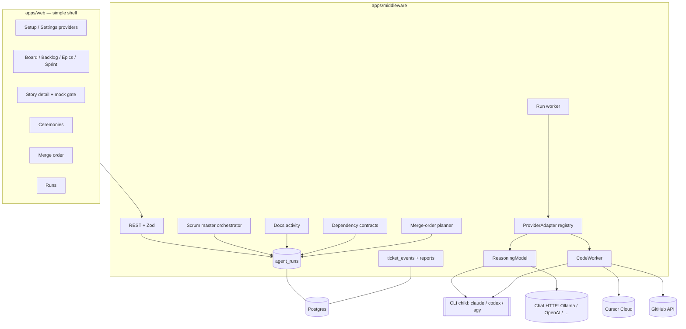
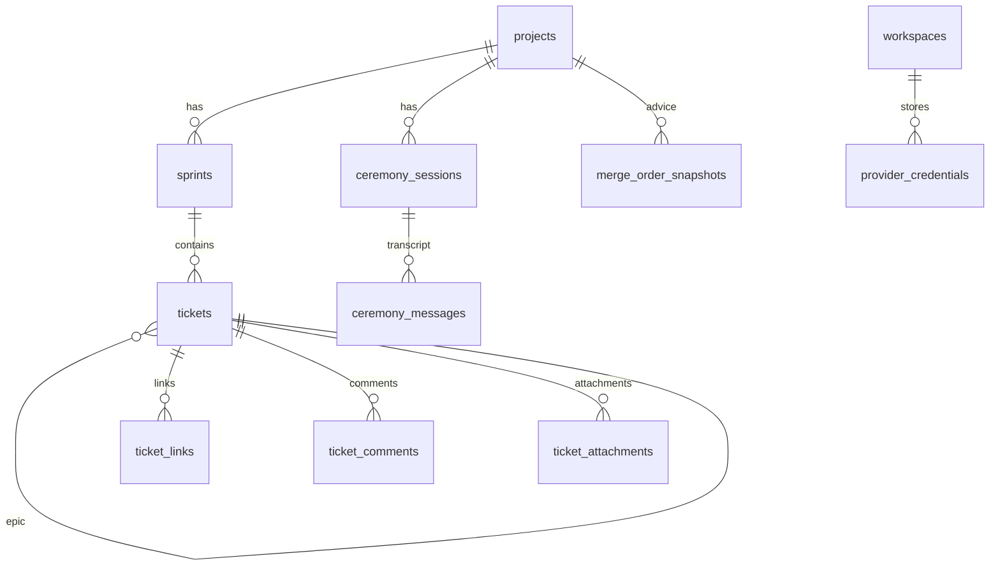
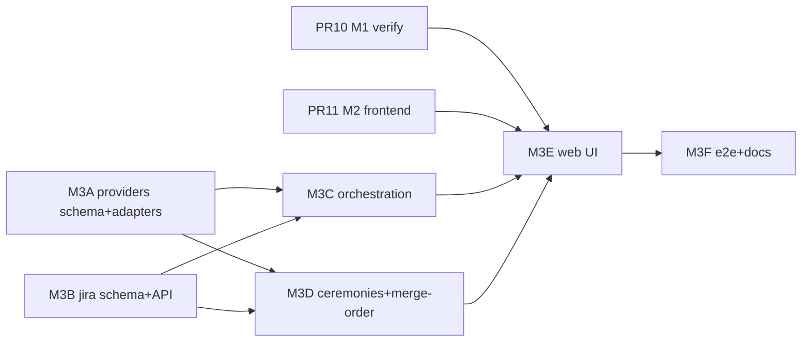

# Milestone 3 — Multi-provider coding company + real Jira workflow

Status: plan only (this PR). No feature code. Author: lead architect, 2026-10-27.
Inputs: `docs/PRODUCT_SPEC.md` (wins on conflict), `docs/milestones/M2_PLAN.md`, `docs/CURSOR_PROVIDER.md`, `PROGRESS.md`.
Base: plan on top of current `main` (M2 backend merged as #9) **plus** open PRs **#10** (M1 verification) and **#11** (M2 frontend), which are being fixed. Do not start M3 implementation PRs until those land or this plan is rebased onto their merged tip.

M3 turns the M2 Cursor-only coding pipeline into a **multi-provider** engineering company with a **real Jira-like board**, agent-to-agent dependency contracts, scrum-master ceremonies, a PR merge-order coordinator, and a documentation agent that writes `confluence/`. High-end models plan; low-end models code from clear instructions. UI mocks gate any story that adds UI.

---

## 0. Open questions for the owner (answer before implementation starts)

1. **Default coding provider.** Keep Cursor as the default coding agent, or switch the product default to Claude Code / Codex / Antigravity once adapters exist? Setup still lets the user pick any.
2. **Ollama / OpenAI-compatible coding.** Neither is a full coding agent. Accept **planning-only** for those providers (coding blocked with a clear Settings message), or require a paired coding CLI (Claude Code / Codex / Cursor) when the chat provider is Ollama?
3. **Antigravity path.** Prefer the local **`agy` CLI** against the ARIA worktree (needs `GEMINI_API_KEY` + `modelProvider: gemini` for true headless), or the Gemini API **remote Antigravity agent** (Google-hosted sandbox — cannot push to the user's GitHub without extra wiring)? Plan default: CLI for coding; Gemini chat for planning fallback.
4. **CLI install policy.** May ARIA assume Claude Code / Codex / Antigravity CLIs are already installed on the host, or should Setup offer install instructions / a binary check only (never auto-download untrusted binaries)?
5. **Story points scale.** M2 shipped Fibonacci 1/2/3/5/8/13 with **1 pt = 1 working day**. Owner M3 text repeats 1 pt = 1 day. Keep Fibonacci, or switch to linear 1..N days only?
6. **UI mock format.** Prefer **static HTML mock** committed under `confluence/mocks/<ticket-key>/`, or **PNG/WebP screenshot** only, or both? Who renders HTML → image in CI (Playwright stub vs pdfkit-style server render)?
7. **Sprint length.** Default sprint = 5 workdays matching the M2 workday calendar, or owner-picked length at project create?
8. **Ceremony schedule.** Daily standup at `ARIA_WORKDAY_START` in `ARIA_TIMEZONE` (M2 default 09:00 UTC), or a separate `ARIA_STANDUP_TIME`?
9. **Dependency verification.** When agent A requests work from B, is “verified end-to-end by A” a **hard gate** before B’s ticket can leave `in_qa`, or advisory until A marks `verified`?
10. **Red/blue in M3.** Product step 11 wants an active attack loop. Ship **scheduled red probes + blue fix tickets** in M3, or keep full chaos sandbox for a later milestone and only wire the **LLM security-review stage** + existing Sprint 6 probe generator here?
11. **PR #6 (JWT).** See §15. Recommend **close #6** — main already has the fix. Confirm.
12. **Secrets UX.** One workspace coding-agent credential set, or allow **per-provider** saved credentials with one “active coding provider” (plan default: per-provider rows, one active)?

### Plan defaults until answered

| # | Default |
|---|---|
| 1 | Cursor remains product default; all others selectable. |
| 2 | Ollama / openai_compatible / custom: `canCode=false` unless a coding CLI is also configured. |
| 3 | Antigravity coding = `agy` CLI; planning fallback = Gemini API chat. |
| 4 | Binary presence check + Setup copy; no auto-install. |
| 5 | Keep Fibonacci; 1 pt = 1 working day (unchanged). |
| 6 | HTML mock + optional Playwright PNG attachment; both stored on the story. |
| 7 | Sprint length 5 workdays, overridable in Settings. |
| 8 | Standup at `ARIA_WORKDAY_START`. |
| 9 | Hard gate: requester must `verify` before the provider story can reach `awaiting_merge`. |
| 10 | M3 ships LLM security-review stage + red/blue **ticket loop** using Sprint 6 probe generator; full chaos sandbox stays later. |
| 11 | Close PR #6. |
| 12 | Per-provider credential rows; one `active_coding_provider`. |

---

## 1. Key decisions

| # | Decision | Why |
|---|---|---|
| D1 | Keep M2’s split: **`ReasoningModel`** (structured JSON, short) and **`CodeWorker`** (long job, branch/PR/usage/cancel). Add a **`ProviderAdapter`** registry that returns both plus **capability flags**. | M2 already fixed the “one interface for chat and agents” mistake. Multi-provider is a registry, not a rewrite. |
| D2 | **Coding provider ≠ chat provider.** Workspace may use Ollama for cheap chat and Cursor/Claude Code for coding. Settings shows both. | Matches owner ask and avoids forcing a coding CLI onto local-only setups. |
| D3 | **Test Connection is a hard gate** in UI and API before credentials become “active.” Store `connection_status`, `last_tested_at`, `last_error` (no secrets). Secrets stay `gcm:v2` encrypted; GET never returns plaintext. | Same pattern as M1 setup; extend to coding CLIs. |
| D4 | Every provider ships a **CI stub** (`ARIA_*_MODE=stub` or shared provider-stub scenarios). Live keys are owner-run smoke only. | CI stays keyless (M2 rule). |
| D5 | **High tier = planning / design / split;** **low tier = code from instructions.** Resolution order unchanged: agent pin → agent tier → project tier → default. New task types: `implementation_design`, `story_split`, `docs_write`, `ceremony`, `merge_order`, `ui_mock`, `dep_request`, `security_review`. | Product spec model tiering + owner M3 wording. |
| D6 | Jira hierarchy: **`epic` → `story` → `sub_task`** on `tickets` (`issue_type`, `parent_id`). Status workflow stays M2 board states plus `design` (UI mock pending) and `blocked` (already exists). | Minimal schema change; board already exists. |
| D7 | **UI mock hard gate:** if `ui_affected=true`, a `ui_ux_designer` agent must attach a mock, owner must approve (`owner_decision` event), only then may develop enqueue. | Owner requirement; prevents FE starting from prose alone. |
| D8 | Approval of a new implementation runs: **docs agent → scrum master split (epics/stories/sub-tasks, AC, points, assignees by flow ownership) → board.** Coding still never merges. | Product steps 8–14. |
| D9 | Agent-to-agent deps are first-class `ticket_links` (`blocks` / `is_blocked_by` / `relates` / `contracts`) plus a **dependency request** run that writes a contract; requester verifies. | Product step 8. |
| D10 | Ceremonies are **text transcripts** in `ceremony_sessions` + messages; scrum master orchestrates via planning-tier runs. No voice. | Product step 12. |
| D11 | Merge-order coordinator is a planning run over open agent PRs (file overlap from GitHub compare); output is ordered advice + suggested rebases. **Never merges.** | Product step 10 + M2 tripwire. |
| D12 | Docs agent writes under repo `confluence/` (Markdown + mermaid). Initial map + every approved implementation. | Product step 14. |
| D13 | Simple UI everywhere: reuse PR #8/#11 primitives; no new design system. Sidebar adds **Backlog**, **Epics**, **Sprints**, **Ceremonies**, **Merge order** only as needed — prefer tabs under Board/Runs over new top-level noise. | Owner: simple UI. |
| D14 | All new ticket mutations append to hash-chained `ticket_events`. Dev/QA md+pdf evidence gate from M2 stays. | Non-negotiable continuity. |

Non-goals for M3: multi-tenant SaaS, agents merging, full chaos-sandbox red/blue (Sprint 14), ideas/proposal pipeline (CEO formal proposals — can stub ceremony hooks only), learning-agent self-rewrite, GitHub webhooks (keep polling), local worktree push unless owner flips Q4 from M2.

---

## 2. Provider research (sources checked 2026-10-27)

### 2.1 Capability matrix

| Provider | Drive headlessly | Auth | `canPlan` | `canCode` | `canOpenPR` | Runtime | Notes |
|---|---|---|---|---|---|---|---|
| **Cursor** | Local `@cursor/sdk` plan mode; Cloud Agents REST v1 | `CURSOR_API_KEY` | yes | yes | yes (`autoCreatePR`) | `cursor_local` / `cursor_cloud` | **Already built in M2.** Docs: [Cloud Agents endpoints](https://cursor.com/docs/cloud-agent/api/endpoints), [TS SDK](https://cursor.com/docs/sdk/typescript), `docs/CURSOR_PROVIDER.md`. |
| **Claude Code** | CLI `claude -p` / `--bare`; Agent SDK TS/Python | `ANTHROPIC_API_KEY` (bare mode ignores OAuth/keychain) | yes (`--permission-mode plan`) | yes (Edit/Bash allowlist) | yes via `gh` in allowlist; ARIA can also open PR with existing GitHub client after agent pushes | `claude_cli` | Docs: [headless](https://code.claude.com/docs/en/headless), [auth](https://code.claude.com/docs/en/authentication), [CLI reference](https://code.claude.com/docs/en/cli-reference), [Agent SDK TS](https://code.claude.com/docs/en/agent-sdk/typescript), [permission modes](https://code.claude.com/docs/en/permission-modes). Prefer `--bare` in CI/automation. |
| **OpenAI Codex** | `codex exec` (non-interactive) | Prefer **`CODEX_API_KEY` inline** for one run; `OPENAI_API_KEY` via `codex login --with-api-key` for persistent | yes (read-only sandbox default) | yes (`--sandbox workspace-write`) | yes via `gh` if sandbox allows network; else ARIA opens PR after push | `codex_cli` | Docs: [non-interactive mode](https://learn.chatgpt.com/docs/non-interactive-mode), [environment variables](https://developers.openai.com/codex/environment-variables), [auth](https://learn.chatgpt.com/docs/auth.md). Do not export API keys job-wide beside untrusted repo code. |
| **Google Antigravity** | CLI `agy -p` / `--print` with `--output-format json\|stream-json`; modes `plan` / `accept-edits` / `auto` | Headless: set `modelProvider: gemini` + `GEMINI_API_KEY` (no Google account session). Interactive cached login hangs in CI. | yes (`--mode plan`) | yes (CLI against cwd; `--dangerously-skip-permissions` only in isolated worktree) | same as other CLIs (`gh` or ARIA PR) | `antigravity_cli` | Docs: [headless](https://antigravity.google/docs/cli/headless/), [CLI reference](https://antigravity.google/docs/cli/reference/), [Gemini Antigravity agent](https://ai.google.dev/gemini-api/docs/antigravity-agent). **Remote** `interactions.create(agent="antigravity-preview-09-2026", environment="remote")` is a Google-hosted sandbox — good for research, **not** the user’s git remote. Fallback for planning-only: existing Gemini chat completions. |
| **Ollama / local** | HTTP `POST /api/chat` or OpenAI-compat `POST /v1/chat/completions` | none (base URL) | yes | **no** (unless paired coding CLI) | no | `chat` | Docs: [chat API](https://docs.ollama.com/api/chat), [OpenAI compatibility](https://docs.ollama.com/api/openai-compatibility). |
| **OpenAI-compatible endpoint** | Chat Completions | API key + base URL | yes | no (unless paired CLI) | no | `chat` | Same as M1 `openai_compatible`. |

### 2.2 Adapter interface (design)

Extend M2 files under `apps/middleware/src/services/models/`:

```ts
export type CodingProviderId =
  | 'cursor' | 'claude_code' | 'codex' | 'antigravity'
  | 'ollama' | 'openai' | 'anthropic' | 'gemini' | 'openai_compatible' | 'custom';

export interface ProviderCapabilities {
  canPlan: boolean;
  canCode: boolean;
  canOpenPR: boolean;          // native PR create (Cursor) vs ARIA-assisted
  headless: 'cli' | 'api' | 'sdk' | 'none';
  needsBinary?: string;        // e.g. 'claude' | 'codex' | 'agy'
  supportsUsage: boolean;
  supportsCancel: boolean;
}

export interface ProviderAdapter {
  id: CodingProviderId;
  capabilities: ProviderCapabilities;
  testConnection(creds: ProviderCredentials): Promise<ConnectionHealth>;
  reasoning(): ReasoningModel;           // throws if !canPlan
  codeWorker(): CodeWorker;              // throws if !canCode
  listModels(): Promise<CatalogEntry[]>;
}
```

`CodeWorker` / `ReasoningModel` signatures stay as in M2 (`codeWorker.ts`, `reasoning.ts`). New workers:

| Adapter | Reasoning | Coding |
|---|---|---|
| Cursor | existing `cursorLocalReasoner` | existing `cursorCloudWorker` |
| Claude Code | `claude -p --bare --permission-mode plan` (or SDK `permissionMode: 'plan'`) → JSON fence | `claude -p --bare` with Edit/Bash allowlist in ARIA worktree; scrubbed env (`ANTHROPIC_API_KEY` only); ARIA `createPull` if agent did not |
| Codex | `codex exec --sandbox read-only --ephemeral` | `codex exec --sandbox workspace-write --ephemeral`; `CODEX_API_KEY` inline |
| Antigravity | `agy -p --mode plan --output-format json` or Gemini chat | `agy -p --mode accept-edits` (or `auto` when sandbox available) in worktree |
| Chat-only | existing `chatReasoner` | **null** — dispatcher refuses `develop` with `PROVIDER_CANNOT_CODE` |

### 2.3 Stub contract (every provider in CI)

Extend `scripts/provider-stub.mjs` (or add sibling stub binaries behind `PATH` wrappers):

- HTTP: Cursor (done), Gemini/OpenAI/Anthropic chat, Ollama `/api/chat` + `/api/tags`.
- CLI stubs: `claude`, `codex`, `agy` scripts on `PATH` in vitest/e2e that honor prompt markers `[[stub:ok]]`, `[[stub:error]]`, `[[stub:usage=N]]`, `[[stub:no_pr]]` and print JSON matching each adapter’s parser.
- Grep test: production code never shells to CLIs when `ARIA_PROVIDER_STUB=1`.

### 2.4 Realistic Antigravity path (summary)

1. **Preferred coding:** install Antigravity CLI; Configure Settings with Gemini API key; ARIA writes an isolated settings dir (do not mutate the user’s `~/.gemini` permanently) with `modelProvider: gemini`; run `agy -p` in the ARIA worktree with stream-json → run logs.
2. **If CLI missing:** Setup shows install docs; coding stays disabled; planning can use Gemini chat (already in M1 provider list).
3. **Do not** treat Gemini remote Antigravity agent as the develop worker for user repos in M3 (wrong filesystem). Revisit if Google adds git-remote binding.

---

## 3. Architecture



Java backend unchanged unless a Flyway-only migration needs `validate` alignment (same M2 rule: avoid Hibernate-mapped tables).

---

## 4. Data model and Flyway migrations

Next free version after M2: **V21+**. Drizzle mirrors; `scripts/check-schema-drift.cjs` extended.

### V21 — `V21__provider_credentials.sql`

```sql
CREATE TABLE IF NOT EXISTS provider_credentials (
  id              UUID PRIMARY KEY DEFAULT uuid_generate_v4(),
  workspace_id    UUID NOT NULL REFERENCES workspaces(id) ON DELETE CASCADE,
  provider        TEXT NOT NULL,
  label           TEXT NOT NULL DEFAULT 'default',
  -- encrypted; never selected by public API serializers
  api_key_encrypted TEXT,
  base_url        TEXT,                     -- ollama / openai_compatible / antigravity settings root override
  extra_encrypted TEXT,                     -- JSON blob for rare fields (still encrypted)
  connection_status TEXT NOT NULL DEFAULT 'untested'
    CHECK (connection_status IN ('untested','ok','failed')),
  last_tested_at  TIMESTAMPTZ,
  last_error      TEXT,                     -- redacted, no key material
  catalog_json    JSONB NOT NULL DEFAULT '[]'::jsonb,
  catalog_refreshed_at TIMESTAMPTZ,
  created_at      TIMESTAMPTZ NOT NULL DEFAULT NOW(),
  updated_at      TIMESTAMPTZ NOT NULL DEFAULT NOW(),
  UNIQUE (workspace_id, provider, label)
);

ALTER TABLE workspaces
  ADD COLUMN IF NOT EXISTS active_coding_provider TEXT,
  ADD COLUMN IF NOT EXISTS active_chat_provider TEXT;

ALTER TABLE projects
  ADD COLUMN IF NOT EXISTS coding_provider TEXT,          -- null = workspace active
  ADD COLUMN IF NOT EXISTS chat_provider TEXT;
```

Migrate existing `workspaces.llm_*` columns into a `provider_credentials` row for the current chat provider (backfill), keep old columns readable for one milestone, then drop in a follow-up if clean.

### V22 — `V22__jira_hierarchy.sql`

```sql
ALTER TABLE tickets
  ADD COLUMN IF NOT EXISTS issue_type TEXT NOT NULL DEFAULT 'story'
    CHECK (issue_type IN ('epic','story','sub_task')),
  ADD COLUMN IF NOT EXISTS parent_id UUID REFERENCES tickets(id) ON DELETE CASCADE,
  ADD COLUMN IF NOT EXISTS epic_id UUID REFERENCES tickets(id) ON DELETE SET NULL,
  ADD COLUMN IF NOT EXISTS acceptance_criteria JSONB NOT NULL DEFAULT '[]'::jsonb,
    -- [{given, when, then}]
  ADD COLUMN IF NOT EXISTS behaviour_notes TEXT,
  ADD COLUMN IF NOT EXISTS ui_affected BOOLEAN NOT NULL DEFAULT FALSE,
  ADD COLUMN IF NOT EXISTS ui_mock_status TEXT NOT NULL DEFAULT 'not_required'
    CHECK (ui_mock_status IN ('not_required','pending','ready_for_owner','approved','rejected')),
  ADD COLUMN IF NOT EXISTS sprint_id UUID,                -- FK added after sprints table
  ADD COLUMN IF NOT EXISTS assignee_agent_id UUID REFERENCES skills(id) ON DELETE SET NULL;

-- Prefer assignee_agent_id; keep legacy assigned_to for Hibernate until a cleanup PR.

CREATE TABLE IF NOT EXISTS ticket_links (
  id           UUID PRIMARY KEY DEFAULT uuid_generate_v4(),
  workspace_id UUID NOT NULL REFERENCES workspaces(id) ON DELETE CASCADE,
  from_ticket_id UUID NOT NULL REFERENCES tickets(id) ON DELETE CASCADE,
  to_ticket_id   UUID NOT NULL REFERENCES tickets(id) ON DELETE CASCADE,
  link_type    TEXT NOT NULL CHECK (link_type IN
                 ('blocks','is_blocked_by','relates','contracts','duplicates')),
  contract_json JSONB,          -- for contracts: what/why/expected outcome
  verified_at  TIMESTAMPTZ,
  verified_by_agent_id UUID REFERENCES skills(id) ON DELETE SET NULL,
  created_at   TIMESTAMPTZ NOT NULL DEFAULT NOW(),
  UNIQUE (from_ticket_id, to_ticket_id, link_type)
);

CREATE TABLE IF NOT EXISTS sprints (
  id           UUID PRIMARY KEY DEFAULT uuid_generate_v4(),
  project_id   UUID NOT NULL REFERENCES projects(id) ON DELETE CASCADE,
  name         TEXT NOT NULL,
  goal         TEXT,
  starts_on    DATE NOT NULL,
  ends_on      DATE NOT NULL,
  status       TEXT NOT NULL DEFAULT 'planned'
    CHECK (status IN ('planned','active','closed')),
  created_at   TIMESTAMPTZ NOT NULL DEFAULT NOW()
);

ALTER TABLE tickets
  ADD CONSTRAINT tickets_sprint_fk FOREIGN KEY (sprint_id) REFERENCES sprints(id) ON DELETE SET NULL;

CREATE TABLE IF NOT EXISTS ticket_comments (
  id           UUID PRIMARY KEY DEFAULT uuid_generate_v4(),
  ticket_id    UUID NOT NULL REFERENCES tickets(id) ON DELETE CASCADE,
  author_type  TEXT NOT NULL CHECK (author_type IN ('owner','agent','system')),
  author_agent_id UUID REFERENCES skills(id) ON DELETE SET NULL,
  body         TEXT NOT NULL,
  created_at   TIMESTAMPTZ NOT NULL DEFAULT NOW()
);

CREATE TABLE IF NOT EXISTS ticket_attachments (
  id           UUID PRIMARY KEY DEFAULT uuid_generate_v4(),
  ticket_id    UUID NOT NULL REFERENCES tickets(id) ON DELETE CASCADE,
  kind         TEXT NOT NULL CHECK (kind IN ('ui_mock_html','ui_mock_image','doc','other')),
  path_in_repo TEXT,            -- e.g. confluence/mocks/ARIA-1001/index.html
  content_type TEXT,
  bytes        BYTEA,           -- small mocks; large blobs stay in git, metadata here
  sha256       TEXT NOT NULL,
  created_by_agent_id UUID REFERENCES skills(id) ON DELETE SET NULL,
  created_at   TIMESTAMPTZ NOT NULL DEFAULT NOW()
);
```

Status: add `design` to shared `TicketStatus` for “mock awaiting owner.” Illegal transitions enforced in `ticketPipeline` (extend M2).

### V23 — `V23__ceremonies_and_merge_order.sql`

```sql
CREATE TABLE IF NOT EXISTS ceremony_sessions (
  id           UUID PRIMARY KEY DEFAULT uuid_generate_v4(),
  project_id   UUID NOT NULL REFERENCES projects(id) ON DELETE CASCADE,
  kind         TEXT NOT NULL CHECK (kind IN ('standup','planning','retro','strategy')),
  status       TEXT NOT NULL DEFAULT 'queued'
    CHECK (status IN ('queued','running','succeeded','failed','cancelled')),
  scheduled_for TIMESTAMPTZ NOT NULL,
  agent_run_id UUID REFERENCES agent_runs(id) ON DELETE SET NULL,
  transcript_md TEXT,
  created_at   TIMESTAMPTZ NOT NULL DEFAULT NOW(),
  finished_at  TIMESTAMPTZ
);

CREATE TABLE IF NOT EXISTS ceremony_messages (
  id           UUID PRIMARY KEY DEFAULT uuid_generate_v4(),
  session_id   UUID NOT NULL REFERENCES ceremony_sessions(id) ON DELETE CASCADE,
  seq          INTEGER NOT NULL,
  speaker_agent_id UUID REFERENCES skills(id) ON DELETE SET NULL,
  role         TEXT NOT NULL CHECK (role IN ('scrum_master','agent','system')),
  body         TEXT NOT NULL,
  created_at   TIMESTAMPTZ NOT NULL DEFAULT NOW(),
  UNIQUE (session_id, seq)
);

CREATE TABLE IF NOT EXISTS merge_order_snapshots (
  id           UUID PRIMARY KEY DEFAULT uuid_generate_v4(),
  project_id   UUID NOT NULL REFERENCES projects(id) ON DELETE CASCADE,
  agent_run_id UUID REFERENCES agent_runs(id) ON DELETE SET NULL,
  advice_json  JSONB NOT NULL,  -- [{prNumber, order, reason, overlaps[], rebaseAfter?}]
  created_at   TIMESTAMPTZ NOT NULL DEFAULT NOW()
);
```

### V24 — activity enum extension

Extend `agent_runs.activity` CHECK to add:

`docs_write`, `story_split`, `ui_mock`, `dep_request`, `ceremony`, `merge_order`, `security_review`, `implementation_design`.

Runtime CHECK adds: `claude_cli`, `codex_cli`, `antigravity_cli`.

### Entity relationships (delta)



---

## 5. API (middleware, Zod-strict, workspace-scoped)

All routes: auth + IDOR via JWT `workspaceId` / project ownership. Secrets never in responses.

### Providers

| Method | Path | Notes |
|---|---|---|
| `GET` | `/api/providers` | Catalog of adapters + capability flags (no secrets). |
| `GET` | `/api/workspaces/me/providers` | Saved rows: status, last_tested_at, base_url host only, catalog ids. |
| `PUT` | `/api/workspaces/me/providers/:provider` | Upsert creds (apiKey?, baseUrl?). Does **not** activate until test passes. |
| `POST` | `/api/workspaces/me/providers/:provider/test` | Live Test Connection. On ok → `connection_status=ok`, refresh catalog, allow activate. |
| `POST` | `/api/workspaces/me/providers/:provider/activate` | Requires `ok` within TTL (e.g. 24h) else 409 `RETEST_REQUIRED`. Sets coding or chat active. |
| `DELETE` | `/api/workspaces/me/providers/:provider` | Deletes encrypted row. |

Project overrides: `PATCH /api/projects/:id` already exists — add optional `codingProvider`, `chatProvider`, tier maps per task-type class.

### Jira workflow

| Method | Path | Notes |
|---|---|---|
| `POST` | `/api/projects/:id/implementations/approve` | Body: title, summary, flows[]. Enqueues docs → story_split pipeline. |
| `GET/POST` | `/api/projects/:id/epics` | List/create epics. |
| `GET` | `/api/projects/:id/backlog` | Stories/sub-tasks not in active sprint. |
| `GET/POST` | `/api/projects/:id/sprints` | Sprint CRUD; `POST …/:sprintId/start\|close`. |
| `POST` | `/api/tickets` | Extended: issueType, parentId, AC, uiAffected, points, links. |
| `POST` | `/api/tickets/:id/sub-tasks` | Agent or owner creates child. |
| `POST` | `/api/tickets/:id/links` | Dependency / contract links. |
| `POST` | `/api/tickets/:id/links/:linkId/verify` | Requester agent or owner verifies contract. |
| `POST` | `/api/tickets/:id/comments` | |
| `POST` | `/api/tickets/:id/ui-mock/submit` | Designer agent (or system) attaches mock → `ready_for_owner`. |
| `POST` | `/api/tickets/:id/ui-mock/approve\|reject` | **Owner only.** Approve unblocks develop. |
| `GET` | `/api/tickets/:id` | Full story detail including AC, links, mock, evidence, timeline. |

### Ceremonies & merge order

| Method | Path | Notes |
|---|---|---|
| `GET/POST` | `/api/projects/:id/ceremonies` | Schedule or list; standup auto-enqueued by cron. |
| `GET` | `/api/projects/:id/ceremonies/:cid` | Transcript. |
| `POST` | `/api/projects/:id/merge-order/refresh` | Enqueues `merge_order` run; returns snapshot id. |
| `GET` | `/api/projects/:id/merge-order` | Latest advice. |

### Runs

Reuse M2 runs API. New activities appear in filters. Cancel/retry unchanged.

---

## 6. Agent orchestration

### 6.1 Approve-implementation pipeline

1. Owner calls `implementations/approve`.
2. Enqueue `docs_write` (docs agent, planning tier) → writes/updates `confluence/**` on a docs branch + PR **or** commits via coding worker with docs-only path allowlist (prefer CodeWorker with path guard: only `confluence/**`).
3. On success, enqueue `implementation_design` + `story_split` (scrum master, planning tier):
   - Input: knowledge map, flow_owners, company roster, docs paths.
   - Output Zod: epics[], stories[] with AC (Given/When/Then), points, flowId/layer, assigneeAgentId, uiAffected, dependencies[], subTasks[].
4. Apply transactionally; append `owner_decision` + `agent_action` events; assign by **flow ownership** (fullstack one owner; else FE/BE split as owner described).
5. For each `uiAffected` story: enqueue `ui_mock` (ui_ux_designer); status `design` until owner approves.
6. Non-UI stories enter backlog / sprint; `ticketDispatcher` picks up when approved and unblocked.

### 6.2 Dependency requests

- Agent A (flow owner) creates link `contracts` to B’s ticket or enqueues `dep_request` which creates B’s sub-task + contract_json.
- B develops under normal review/QA/evidence.
- A must `verify` (planning run or explicit API) before B can enter `awaiting_merge` if the link is `blocks`/`contracts` (D9 hard gate).
- Verification failure → fix round on B, communication events both ways.

### 6.3 Ceremonies (scrum master)

- Cron at standup time: create `ceremony_sessions`, enqueue `ceremony` run.
- Scrum master planning run calls each ON agent in org order (yesterday/today/blockers); optional follow-up turns (cap 1 follow-up per agent to save tokens).
- Sprint planning / retro: owner-triggered or end-of-sprint automatic.
- Transcript stored as Markdown + structured messages; visible in UI. **No tokens for OFF agents.**

### 6.4 Merge-order coordinator

- Inputs: open PRs for project tickets in `awaiting_merge` or `ready_for_review`/`in_qa`, file lists from GitHub API, ticket dependency links.
- Output: ordered list + conflict reasons. Refresh on PR open/close (prWatcher hook) and manual refresh.
- UI shows order; owner still merges manually.

### 6.5 Security review stage

- When `ARIA_SECURITY_REVIEW=true` (M3 default **on** for new projects, config flag): after QA pass, enqueue `security_review` (planning tier, read-only on PR diff) before `awaiting_merge`.
- Red team: scheduled job creates probe tickets from Sprint 6 `redTeam.service`; blue team agents get fix tickets. Loop until probes clean or round cap.

### 6.6 Visual regression (M3)

- Enable `ARIA_QA_BROWSER` path: QA coding run or middleware Playwright against preview URL **optional**; minimum viable: compare before/after PNGs already required in evidence (`ui_affected`) with a deterministic perceptual-hash / pixeldiff gate in middleware (no flaky full suite). Full visual suite can grow later; do not skip the gate with empty screenshots (anti-test-dodging).

---

## 7. UI screens (simple)

Fits simplified shell from #8 / #11. Prefer tabs over new sidebar entries.

| Screen | Content |
|---|---|
| **Setup / Settings → Providers** | List providers with capability badges. Select → credential fields (API key and/or base URL) → **Test Connection** → only then Enable. Show last tested time + health. Active coding vs chat selectors. Tier defaults per provider + per task class. |
| **Board** | Existing columns + `Design` for mock-pending. Cards show type icon (epic/story/sub-task), points, sprint, blocker flag, mock status. |
| **Backlog** | Flat list / simple filter; bulk add to sprint. |
| **Epics** | Epic list → child stories progress bar (done/total points). |
| **Story detail** | Description, behaviour, AC list, points, assignee, links, comments, mock preview + Approve/Reject (owner), evidence downloads, timeline (M2). |
| **Sprint** | Active sprint header, burndown-ish simple counts (not a chart clutter), ceremony button. |
| **Ceremonies** | List + transcript `LogView`. |
| **Merge order** | Numbered PR list with overlap chips + “Refresh”. |
| **Runs** | Filters include new activities. |

No cards-in-hero; no new accent system. Mobile: same three Playwright viewports.

---

## 8. Gates (hard)

| Gate | When | Failure |
|---|---|---|
| Test Connection | Activate provider / finish Setup step | 409; UI blocks Continue |
| Provider canCode | Enqueue develop/fix/qa coding | `PROVIDER_CANNOT_CODE` |
| UI mock approved | Enqueue develop on `ui_affected` story | Stay `design` / blocked |
| Dependency verified | Provider story → `awaiting_merge` | Block + communication |
| Docs completed | story_split after implementation approve | Retry docs; no silent skip |
| AC present | story_split apply | Zod reject; template forbidden for empty AC |
| M2 evidence md+pdf | QA → awaiting_merge | Fix round (unchanged) |
| Security review | If enabled, before awaiting_merge | Fix round |
| Merge tripwire | Any GitHub merge path | Throw (unchanged) |
| Secrets | Any GET | Never return apiKey |

---

## 9. Security

- **Secret storage:** reuse `encryptSecret` / `gcm:v2` with AAD `(workspaceId, column)`. CLI children get scrubbed env (only the one provider key + `PATH`/`HOME`/`LANG`). Keys never in argv, git config, or run logs (extend redaction).
- **Prompt injection:** all agent-visible ticket/AC/comment text passes Sprint 6 `Sanitizer` before prompt assembly; quarantine ≥0.70.
- **Path allowlists:** docs runs may only write `confluence/**`; mock runs `confluence/mocks/**`; develop keeps M2 `diffGuards` (no workflows secrets).
- **Permission modes:** Claude/Codex/Antigravity never use “dangerously skip” on the owner’s primary checkout — only inside ARIA worktree under `ARIA_DATA_DIR`.
- **Red/blue:** probes from Sprint 6 generator; findings → tickets; no destructive probes against production without owner flag (local project only).
- **IDOR / Zod / Helmet / rate limits:** every new route.
- **PR #6 note:** see §15.

---

## 10. Token minimization

- Planning tier only for: split, design, ceremonies (scrum master turns), merge-order, security review, dep verify.
- Development tier for: code, tests, docs file edits, mocks.
- Ceremony: one follow-up max; OFF agents skipped; standup payload is per-agent delta (ticket keys + blockers), not full repo.
- Merge-order: file lists from GitHub API, not full diff, into the planner.
- Story_split: single structured JSON call with schema; no multi-agent debate loop in M3.
- Reuse M2 monthly buckets; tag `backend_id` per provider runtime.
- Needle/distillation (Sprint 8) for large repo context on planning calls when available; otherwise path-restricted tree summaries.

---

## 11. Test plan (no dodging)

### Unit (vitest)

- Provider registry capabilities; `testConnection` gate; activate TTL.
- CLI argument builders never include secrets in argv.
- Log redaction for `ANTHROPIC_API_KEY`, `CODEX_API_KEY`, `GEMINI_API_KEY`, `OPENAI_API_KEY`.
- Story_split Zod (AC required, points fib, assignee in project).
- UI mock state machine; dependency verify gate.
- ticketPipeline new transitions (`design`, epic/sub_task rules).
- Merge-order overlap algorithm (pure).
- Sanitizer on AC/comment ingress.

### Integration (vitest + Postgres)

- Provider credential encrypt/decrypt + GET shape has no secrets.
- Approve-implementation → docs → split → rows + events hash chain.
- Mock approve required before develop enqueue.
- Ceremony session messages seq uniqueness.
- Stub CLI PATH workers for claude/codex/agy.
- Drift check V21–V24.

### Playwright (desktop / tablet / mobile)

New specs (add to CI e2e list; **do not delete** protected sprint/milestone specs):

1. `m3-providers.spec.ts` — select provider, fail test, pass test, activate, Settings health.
2. `m3-jira-board.spec.ts` — epic/story/sub-task, AC visible, backlog → sprint → board.
3. `m3-ui-mock-gate.spec.ts` — story with UI cannot start develop until owner approves mock.
4. `m3-deps.spec.ts` — contract link blocks awaiting_merge until verify.
5. `m3-ceremonies.spec.ts` — standup transcript renders.
6. `m3-merge-order.spec.ts` — refresh shows ordered PRs against stub.

Anti-test-dodging + anti-slop CI jobs must stay green. No `it.skip` for new coverage.

### Live smoke (owner, not CI)

`pnpm -F @aria/middleware smoke:providers` — optional per-key matrix; skip unset keys with exit 0 (same pattern as `smoke:cursor`).

---

## 12. Independently mergeable PRs (sequence + parallelism)



| PR | Branch suggestion | Scope | Depends on | Parallel with |
|---|---|---|---|---|
| **M3A** | `feat/sprint-m3-providers` | V21, ProviderAdapter registry, Claude/Codex/Antigravity/Ollama stubs, Test Connection + activate APIs, Settings/Setup API wiring, unit tests | main + #10/#11 merged tip | **M3B** |
| **M3B** | `feat/sprint-m3-jira-model` | V22, ticket hierarchy/links/comments/attachments/sprints APIs, pipeline status `design`, event types | same tip | **M3A** |
| **M3C** | `feat/sprint-m3-orchestration` | docs_write, story_split, ui_mock, dep_request, security_review activities; approve-implementation; gates | M3A + M3B | M3D after M3A/B |
| **M3D** | `feat/sprint-m3-ceremonies-merge` | V23, ceremony runner, merge-order planner, prWatcher hook | M3A + M3B | **M3C** |
| **M3E** | `feat/sprint-m3-web` | Providers UI, board/backlog/epic/sprint/story/mock/ceremony/merge-order screens | M3C + M3D + #11 | — |
| **M3F** | `feat/sprint-m3-e2e` | Playwright specs ×3 viewports, smoke script, `docs/PROVIDERS.md`, PROGRESS update | M3E | — |

Each PR: typecheck, lint, vitest, drift check, no protected E2E edits, agents never merge.

---

## 13. Ordered task list (implementation agents)

| # | Task | PR | Acceptance |
|---|---|---|---|
| A1 | V21 + Drizzle + backfill from workspace LLM columns | M3A | Drift green; secrets encrypted |
| A2 | `ProviderAdapter` types + registry + capability table | M3A | Unit tests for flags |
| A3 | Cursor adapter wraps existing M2 workers | M3A | No behavior regress on stub |
| A4 | Claude Code CLI reasoner + worker + stub binary | M3A | Stub plan/code; env scrub test |
| A5 | Codex CLI reasoner + worker + stub | M3A | Same |
| A6 | Antigravity CLI + Gemini planning fallback + stub | M3A | CLI missing → clear error; chat fallback plans |
| A7 | Ollama/openai_compatible chat-only adapters | M3A | `canCode=false` enforced |
| A8 | Test/activate APIs + health fields | M3A | Cannot activate without ok |
| B1 | V22 hierarchy/links/sprints/comments/attachments | M3B | Drift green |
| B2 | Ticket APIs + Zod AC schema | M3B | IDOR tests |
| B3 | Pipeline `design` + sub_task rules | M3B | Illegal transitions rejected |
| C1 | `docs_write` activity + confluence path guard | M3C | Only `confluence/**` |
| C2 | `story_split` + assign by flow_owners | M3C | Fixture org assignment test |
| C3 | `ui_mock` + owner approve gate | M3C | Develop blocked until approve |
| C4 | `dep_request` + verify gate | M3C | awaiting_merge blocked |
| C5 | `security_review` + red/blue ticket loop flag | M3C | Flag off skips stage |
| D1 | V23 ceremonies + merge_order tables | M3D | |
| D2 | Standup/planning/retro runner | M3D | OFF agents skipped |
| D3 | Merge-order overlap + snapshot API | M3D | Deterministic fixture |
| E1 | Providers Setup/Settings UI + Test Connection gate | M3E | |
| E2 | Board/backlog/epic/sprint/story UI | M3E | Simple, 3 viewports |
| E3 | Mock approve UX + ceremonies + merge order pages | M3E | |
| F1 | Playwright m3-* specs on 3 projects | M3F | CI green, no skips |
| F2 | `docs/PROVIDERS.md` + PROGRESS + smoke:providers | M3F | |

---

## 14. Risks

| Risk | Mitigation |
|---|---|
| CLI version drift (claude/codex/agy flags change) | Adapter per provider; stub contract tests; pin documented min versions in Settings. |
| Antigravity remote agent ≠ user repo | Do not use remote agent for develop in M3. |
| Ollama users expect coding | Explicit UI copy + `PROVIDER_CANNOT_CODE`. |
| Ceremony token blowups | Caps, OFF skip, delta-only prompts. |
| Jira UI complexity | Tabs + existing primitives; no new dashboard chrome. |
| Parallel M3A/M3B merge conflicts on `agent_runs` CHECK | Coordinate enum extension in **one** migration owner (M3A owns activity enum; M3B does not touch it) — story_split activities land in M3A or a tiny M3A.1 if needed. Prefer **M3A owns V24 activity enum**; M3C enables the handlers. |
| #10/#11 still open | Rebase M3 branches after they merge; plan assumes their APIs (`catalogModelIds`, timeline UI). |

---

## 15. PR #6 (JWT RS256 key encoding) — verdict

**Main already fixed this. PR #6 is not needed for the bugfix.**

Evidence on current `main` (`1b6e555` lineage):

- `apps/middleware/src/config/jwt.ts` decodes PEM via `decodePem`: accepts literal PEM (`BEGIN`) or base64 (as emitted by `scripts/generate-keys.sh`); signs access tokens with `type: 'access'`; verifies with `getJwtPublicKeyPem()`.
- `apps/middleware/src/middleware/auth.middleware.ts` and `apps/middleware/src/ws/index.ts` verify access tokens with that helper / `type: 'access'`.
- Commit message on history: `fix(middleware): verify RS256 tokens with the key that signed them`.

PR #6 is **OPEN + CONFLICTING** with main. Its diff is the same fix plus `jwt-pem.test.ts`. The dedicated unit test file is **not** on main.

**Recommendation:** close #6 as superseded. Optionally cherry-pick only `apps/middleware/src/__tests__/jwt-pem.test.ts` into a tiny chore PR (or into M3A) — nice-to-have, not a blocker.

---

## 16. Definition of Done (M3)

- [ ] All six implementation PRs merged (or equivalent stacked set)
- [ ] Every provider has a CI stub; Test Connection gate enforced in UI and API
- [ ] High/low tier routing covered by tests for new task types
- [ ] Jira hierarchy + AC + points + links + sprint + mock gate working
- [ ] Docs agent writes `confluence/`; scrum ceremonies transcripts visible; merge-order advice visible
- [ ] Dependency verification hard gate on
- [ ] M2 evidence + ticket_events chain still green
- [ ] Playwright m3 specs pass on desktop/tablet/mobile; anti-test-dodging clean
- [ ] `docs/PROVIDERS.md` cites the sources in §2
- [ ] PROGRESS.md updated; agents still never merge

---

## 17. Out of scope (explicit)

Ideas → formal CEO/CFO proposals (product step 13) beyond ceremony hooks; learning-agent self-modification; multi-tenant; GitHub webhooks; agents merging; full chaos sandbox; Horizon Scanner; Genesis. Local worktree Contents-write fallback remains opt-in from M2 defaults.
