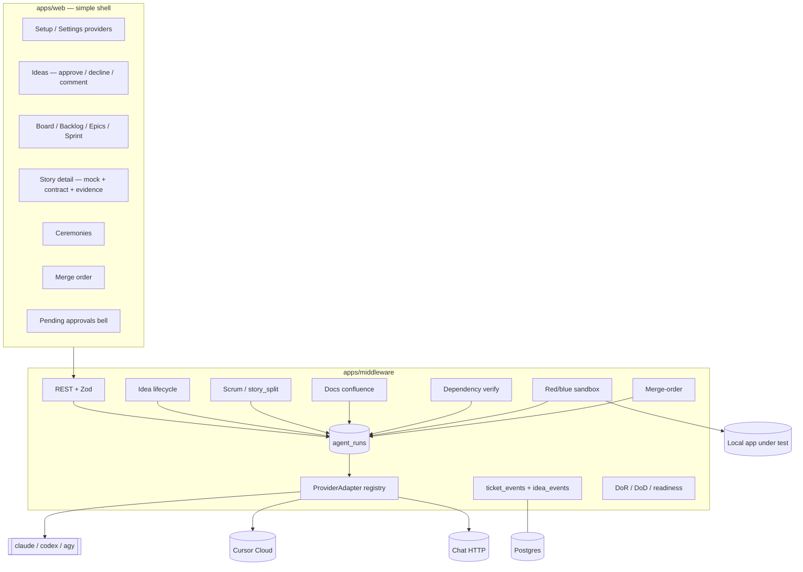
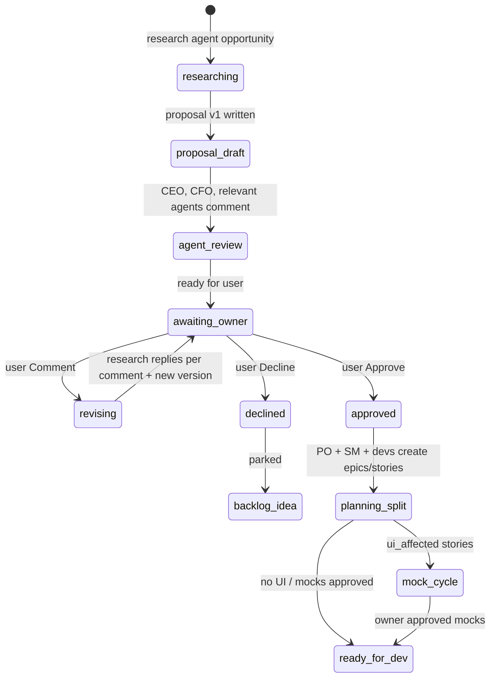
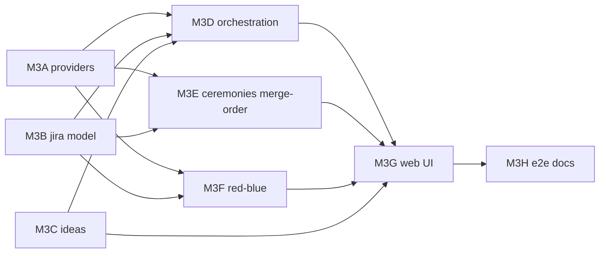

# Milestone 3 — Multi-provider coding company + real Jira workflow

Status: plan only (this PR). No feature code. Author: lead architect, 2026-10-27 (rev 2 — owner decisions locked).
Inputs: `docs/PRODUCT_SPEC.md` (wins on conflict), `docs/milestones/M2_PLAN.md`, `docs/CURSOR_PROVIDER.md`, `PROGRESS.md`.
Base: current `main` with M2 backend (#9) and **M2 frontend (#11) merged**. Open PR #10 (M1 verification) is independent; rebase if it lands later. PR #6 closed (JWT already on main).

M3 turns the M2 Cursor-only coding pipeline into a **multi-provider** engineering company with a **real Jira-like board**, an **idea → proposal → approve** lifecycle, agent-to-agent dependency contracts, scrum ceremonies, a PR merge-order coordinator, documentation under `confluence/`, and a **full red/blue security loop** against the local stack. Planning uses any capable provider; coding lists only coding-capable agents. High-end models plan; low-end models code from clear instructions. UI mocks (HTML + every-state PNGs) gate any story that adds UI. Agents never merge.

---

## 0. Decisions (owner-locked, 2026-10-27)

| # | Decision |
|---|---|
| 1 | **No product-default provider.** Setup lists options; the user picks and connects the agent(s) they want. That choice becomes the **project’s** default for each tier. Changeable anytime in Settings. |
| 2 | **Capability-filtered lists.** Planning tier: any provider that can plan (incl. Ollama, OpenAI-compatible, Gemini, Claude, Codex, Cursor, Antigravity). Coding tier: **only** coding-capable agents (Claude Code, Cursor, Codex, Antigravity). If a local/model provider later gains `canCode=true`, show it in coding; otherwise **omit it from the coding list entirely** (never show-and-block). |
| 3 | **Auth / Antigravity / CLIs.** Claude Code and Codex: **API key only** for now (no subscription/OAuth login). Antigravity: Google Gemini path — `agy` CLI + `GEMINI_API_KEY` for coding; Gemini API chat for planning. Assume CLIs are installed; still **detect the binary** and show install steps if missing; **never auto-install**. |
| 4 | **Story points.** Fibonacci `1,2,3,5,8,13`. Estimated working days **round up** to the next Fibonacci (1→1, 2→3, 4→5, …). Due date = points as working days (M2 calendar: Sat/Sun off). |
| 5 | **UI mocks.** HTML mock **plus** PNG images for **every state**: default, modals/dialogs, empty, error, loading, and interaction outcomes (what appears when each button is clicked). All attached to the story. |
| 6 | **Sprint length.** **10 working days** (2 weeks, Sat/Sun off). |
| 7 | **Standup time.** Configurable in Settings; default **08:00** in the **user’s timezone** (`ARIA_TIMEZONE` / project timezone). |
| 8 | **Dependency gate is hard.** Requester agent A must test B’s entire implementation end-to-end and verify before B’s story can reach `awaiting_merge`. |
| 9 | **Red/blue full scope in M3.** Security-review stage + scheduled **and** randomized red-team attacks against the **running local app** (auth bypass, IDOR, injection, XSS, SSRF, secrets/DB leakage, prompt injection). Each finding → ticket; blue team fixes via tickets with evidence. Sandboxed to local stack only. |
| 10 | **Credentials.** Per-provider credential rows; **one active provider per tier** (`planning`, `coding`). |
| 11 | **PR #6** closed — main already has the JWT PEM/`type: access` fix. |

Config defaults that follow:

| Setting | Value |
|---|---|
| `ARIA_SPRINT_WORKDAYS` | `10` |
| `ARIA_STANDUP_TIME` | `08:00` (project timezone) |
| `ARIA_SECURITY_REVIEW` | `true` |
| `ARIA_RED_BLUE_ENABLED` | `true` (local stack only) |
| `ARIA_QA_BROWSER` | `true` for mock/interaction evidence capture in coding/QA runs (middleware still does not merge) |
| Fibonacci round-up | `ceilFib(days)` helper shared by planner and API |

---

## 1. Key design decisions (architect)

| # | Decision | Why |
|---|---|---|
| D1 | Keep M2 **`ReasoningModel`** / **`CodeWorker`**; add **`ProviderAdapter`** registry + capability flags. | Multi-provider is a registry, not a rewrite. |
| D2 | **Active provider per tier** (planning vs coding), not one global provider. Project inherits workspace actives; Settings overrides per project. | Decision 1 + 10. |
| D3 | **Test Connection hard gate** before a credential row can become the active provider for a tier. Store `connection_status`, `last_tested_at`, `last_error`. Secrets `gcm:v2`; never returned. | M1 pattern extended to coding CLIs. |
| D4 | CI stubs for every adapter (HTTP + CLI PATH shims). Live keys = owner smoke only. | Keyless CI. |
| D5 | High tier = planning/design/split/ceremony/merge-order/security/idea review; low tier = code/tests/docs file edits/mocks from instructions. Resolution: agent pin → agent tier → project tier → active provider default. | Product + Decision 2. |
| D6 | Jira hierarchy `epic` → `story` → `sub_task`; status adds `design` (mock pending) and keeps M2 states. | Minimal board change. |
| D7 | UI mock hard gate: designer → PO+SM review → owner approve/comment loop → only then develop. | Decision 5 + idea flow. |
| D8 | Docs agent → `confluence/`; scrum ceremonies as text; merge-order advice only; agents never merge. | Product 10–14. |
| D9 | Dependency `contracts` + hard verify by requester A. | Decision 8. |
| D10 | Idea lifecycle is first-class (§6): research → proposal versions → CEO/CFO/agent comments → owner Approve/Decline/Comment loop → planning split. | Owner NEW REQUIRED FLOW. |
| D11 | FE↔BE **API contract** on the story; FE click-by-click evidence; BE persistence evidence; both in md+pdf reports. | Owner flow. |
| D12 | Company readiness extras (§7): DoR/DoD, story readiness check, contract tests, rollback plan, release notes, approval notifications, SLA escalation. | Real-company gaps; simple UI. |
| D13 | All comments, versions, approvals, agent messages → hash-chained `ticket_events` (+ idea_events where needed). | Proof log. |
| D14 | Simple UI: reuse #8/#11 primitives; prefer tabs under Board / Ideas / Settings over sidebar sprawl. | Owner. |

Non-goals: multi-tenant SaaS, agents merging, GitHub webhooks (keep polling), learning-agent self-rewrite, Horizon Scanner, Genesis, auto-install of CLIs, subscription OAuth for Claude/Codex.

---

## 2. Provider research (sources checked 2026-10-27)

### 2.1 Capability matrix (drives UI lists)

| Provider | Headless drive | Auth (M3) | `canPlan` | `canCode` | Shown in planning list | Shown in coding list | Runtime |
|---|---|---|---|---|---|---|---|
| **Cursor** | SDK plan + Cloud Agents REST | API key | yes | yes | yes | yes | `cursor_local` / `cursor_cloud` |
| **Claude Code** | `claude -p --bare` / Agent SDK | `ANTHROPIC_API_KEY` only | yes | yes | yes | yes | `claude_cli` |
| **Codex** | `codex exec` | API key (`CODEX_API_KEY` / OpenAI key); no ChatGPT login | yes | yes | yes | yes | `codex_cli` |
| **Antigravity** | `agy -p` (+ Gemini chat for plan) | `GEMINI_API_KEY` | yes | yes (CLI) | yes | yes | `antigravity_cli` / `chat` |
| **Gemini** (API only) | Chat completions | API key | yes | no | yes | **no** | `chat` |
| **Ollama** | HTTP `/api/chat` or `/v1/chat/completions` | base URL | yes | no* | yes | **no*** | `chat` |
| **OpenAI / Anthropic chat** | Chat Completions / Messages | API key | yes | no | yes | **no** | `chat` |
| **OpenAI-compatible / custom** | Chat Completions | key + base URL | yes | no* | yes | **no*** | `chat` |

\*If a future adapter sets `canCode=true` (e.g. a local agent binary), it appears in the coding list automatically. Until then it is omitted, not disabled-in-place.

Sources: [Claude Code headless](https://code.claude.com/docs/en/headless), [auth](https://code.claude.com/docs/en/authentication), [Agent SDK TS](https://code.claude.com/docs/en/agent-sdk/typescript); [Codex non-interactive](https://learn.chatgpt.com/docs/non-interactive-mode), [env vars](https://developers.openai.com/codex/environment-variables); [Antigravity headless](https://antigravity.google/docs/cli/headless/), [CLI reference](https://antigravity.google/docs/cli/reference/), [Gemini Antigravity agent](https://ai.google.dev/gemini-api/docs/antigravity-agent); [Ollama chat](https://docs.ollama.com/api/chat), [OpenAI compat](https://docs.ollama.com/api/openai-compatibility); Cursor — `docs/CURSOR_PROVIDER.md`.

**Antigravity path (locked):** coding = `agy` CLI in ARIA worktree with Gemini key; planning may use Gemini chat API. Do not use Google-hosted remote Antigravity sandbox as the develop worker for the user’s git repo. Binary missing → Setup/Settings shows install steps; coding activate fails until present.

### 2.2 Adapter interface

```ts
export type TierKind = 'planning' | 'coding';

export interface ProviderCapabilities {
  canPlan: boolean;
  canCode: boolean;
  canOpenPR: boolean;
  headless: 'cli' | 'api' | 'sdk' | 'none';
  needsBinary?: string;       // 'claude' | 'codex' | 'agy'
  supportsUsage: boolean;
  supportsCancel: boolean;
}

export interface ProviderAdapter {
  id: string;
  capabilities: ProviderCapabilities;
  testConnection(creds: ProviderCredentials): Promise<ConnectionHealth>;
  detectBinary(): Promise<{ ok: boolean; path?: string; installHint?: string }>;
  reasoning(): ReasoningModel;  // require canPlan
  codeWorker(): CodeWorker;     // require canCode
  listModels(): Promise<CatalogEntry[]>;
}

/** UI/API helper — never returns canCode=false rows for coding tier. */
export function providersForTier(tier: TierKind): ProviderAdapter[];
```

### 2.3 CI stubs

Extend `scripts/provider-stub.mjs` + PATH shims `claude` / `codex` / `agy` honoring `[[stub:…]]` markers. Grep: no live CLI spawn when `ARIA_PROVIDER_STUB=1`.

---

## 3. Architecture



---

## 4. Data model and Flyway (V21+)

### V21 — `provider_credentials` + per-tier actives

```sql
CREATE TABLE IF NOT EXISTS provider_credentials (
  id UUID PRIMARY KEY DEFAULT uuid_generate_v4(),
  workspace_id UUID NOT NULL REFERENCES workspaces(id) ON DELETE CASCADE,
  provider TEXT NOT NULL,
  label TEXT NOT NULL DEFAULT 'default',
  api_key_encrypted TEXT,
  base_url TEXT,
  extra_encrypted TEXT,
  connection_status TEXT NOT NULL DEFAULT 'untested'
    CHECK (connection_status IN ('untested','ok','failed')),
  last_tested_at TIMESTAMPTZ,
  last_error TEXT,
  binary_status TEXT NOT NULL DEFAULT 'unknown'
    CHECK (binary_status IN ('unknown','ok','missing','not_required')),
  catalog_json JSONB NOT NULL DEFAULT '[]'::jsonb,
  catalog_refreshed_at TIMESTAMPTZ,
  created_at TIMESTAMPTZ NOT NULL DEFAULT NOW(),
  updated_at TIMESTAMPTZ NOT NULL DEFAULT NOW(),
  UNIQUE (workspace_id, provider, label)
);

-- One active provider per tier (workspace default; project may override)
ALTER TABLE workspaces
  ADD COLUMN IF NOT EXISTS active_planning_provider TEXT,
  ADD COLUMN IF NOT EXISTS active_coding_provider TEXT;
ALTER TABLE projects
  ADD COLUMN IF NOT EXISTS planning_provider TEXT,
  ADD COLUMN IF NOT EXISTS coding_provider TEXT,
  ADD COLUMN IF NOT EXISTS timezone TEXT NOT NULL DEFAULT 'UTC',
  ADD COLUMN IF NOT EXISTS standup_time TEXT NOT NULL DEFAULT '08:00',
  ADD COLUMN IF NOT EXISTS sprint_workdays INTEGER NOT NULL DEFAULT 10;
```

Backfill existing workspace LLM row into `provider_credentials`; map prior single provider to both actives only if `canCode`, else planning only and leave coding unset until Setup completes.

### V22 — Jira hierarchy, links, sprints, mocks, contracts

```sql
ALTER TABLE tickets
  ADD COLUMN IF NOT EXISTS issue_type TEXT NOT NULL DEFAULT 'story'
    CHECK (issue_type IN ('epic','story','sub_task')),
  ADD COLUMN IF NOT EXISTS parent_id UUID REFERENCES tickets(id) ON DELETE CASCADE,
  ADD COLUMN IF NOT EXISTS epic_id UUID REFERENCES tickets(id) ON DELETE SET NULL,
  ADD COLUMN IF NOT EXISTS acceptance_criteria JSONB NOT NULL DEFAULT '[]'::jsonb,
  ADD COLUMN IF NOT EXISTS behaviour_notes TEXT,
  ADD COLUMN IF NOT EXISTS ui_affected BOOLEAN NOT NULL DEFAULT FALSE,
  ADD COLUMN IF NOT EXISTS ui_mock_status TEXT NOT NULL DEFAULT 'not_required'
    CHECK (ui_mock_status IN (
      'not_required','pending_designer','pending_po_sm','pending_owner',
      'changes_requested','approved')),
  ADD COLUMN IF NOT EXISTS api_contract JSONB,  -- request/response/validation/errors
  ADD COLUMN IF NOT EXISTS dor_checklist JSONB NOT NULL DEFAULT '[]'::jsonb,
  ADD COLUMN IF NOT EXISTS dod_checklist JSONB NOT NULL DEFAULT '[]'::jsonb,
  ADD COLUMN IF NOT EXISTS readiness_status TEXT NOT NULL DEFAULT 'not_ready'
    CHECK (readiness_status IN ('not_ready','ready','blocked')),
  ADD COLUMN IF NOT EXISTS rollback_plan TEXT,
  ADD COLUMN IF NOT EXISTS sprint_id UUID,
  ADD COLUMN IF NOT EXISTS assignee_agent_id UUID REFERENCES skills(id) ON DELETE SET NULL,
  ADD COLUMN IF NOT EXISTS idea_id UUID;  -- FK after ideas_v2

CREATE TABLE IF NOT EXISTS ticket_links (
  id UUID PRIMARY KEY DEFAULT uuid_generate_v4(),
  workspace_id UUID NOT NULL REFERENCES workspaces(id) ON DELETE CASCADE,
  from_ticket_id UUID NOT NULL REFERENCES tickets(id) ON DELETE CASCADE,
  to_ticket_id UUID NOT NULL REFERENCES tickets(id) ON DELETE CASCADE,
  link_type TEXT NOT NULL CHECK (link_type IN
    ('blocks','is_blocked_by','relates','contracts','duplicates')),
  contract_json JSONB,
  verified_at TIMESTAMPTZ,
  verified_by_agent_id UUID REFERENCES skills(id) ON DELETE SET NULL,
  verification_report TEXT,
  created_at TIMESTAMPTZ NOT NULL DEFAULT NOW(),
  UNIQUE (from_ticket_id, to_ticket_id, link_type)
);

CREATE TABLE IF NOT EXISTS sprints (
  id UUID PRIMARY KEY DEFAULT uuid_generate_v4(),
  project_id UUID NOT NULL REFERENCES projects(id) ON DELETE CASCADE,
  name TEXT NOT NULL,
  goal TEXT,
  starts_on DATE NOT NULL,
  ends_on DATE NOT NULL,          -- 10 working days from start
  status TEXT NOT NULL DEFAULT 'planned'
    CHECK (status IN ('planned','active','closed')),
  created_at TIMESTAMPTZ NOT NULL DEFAULT NOW()
);
ALTER TABLE tickets
  ADD CONSTRAINT tickets_sprint_fk FOREIGN KEY (sprint_id) REFERENCES sprints(id) ON DELETE SET NULL;

CREATE TABLE IF NOT EXISTS ticket_comments (
  id UUID PRIMARY KEY DEFAULT uuid_generate_v4(),
  ticket_id UUID NOT NULL REFERENCES tickets(id) ON DELETE CASCADE,
  author_type TEXT NOT NULL CHECK (author_type IN ('owner','agent','system')),
  author_agent_id UUID REFERENCES skills(id) ON DELETE SET NULL,
  body TEXT NOT NULL,
  created_at TIMESTAMPTZ NOT NULL DEFAULT NOW()
);

CREATE TABLE IF NOT EXISTS ticket_attachments (
  id UUID PRIMARY KEY DEFAULT uuid_generate_v4(),
  ticket_id UUID NOT NULL REFERENCES tickets(id) ON DELETE CASCADE,
  kind TEXT NOT NULL CHECK (kind IN (
    'ui_mock_html','ui_mock_png','interaction_png','doc','other')),
  state_key TEXT,                 -- e.g. default|empty|error|loading|modal:confirm|click:save
  path_in_repo TEXT,
  content_type TEXT,
  bytes BYTEA,
  sha256 TEXT NOT NULL,
  created_by_agent_id UUID REFERENCES skills(id) ON DELETE SET NULL,
  created_at TIMESTAMPTZ NOT NULL DEFAULT NOW()
);
```

Points: keep Fibonacci CHECK; add shared `ceilFib(n)` for day→points. Due date from points × workday calendar (unchanged math, sprint default length 10).

### V23 — ceremonies, merge order, notifications

```sql
CREATE TABLE IF NOT EXISTS ceremony_sessions ( /* standup|planning|retro|strategy — as prior draft */ );
CREATE TABLE IF NOT EXISTS ceremony_messages ( /* seq transcript */ );
CREATE TABLE IF NOT EXISTS merge_order_snapshots ( /* advice_json */ );

CREATE TABLE IF NOT EXISTS user_notifications (
  id UUID PRIMARY KEY DEFAULT uuid_generate_v4(),
  workspace_id UUID NOT NULL REFERENCES workspaces(id) ON DELETE CASCADE,
  project_id UUID REFERENCES projects(id) ON DELETE CASCADE,
  kind TEXT NOT NULL CHECK (kind IN (
    'idea_awaiting_owner','mock_awaiting_owner','approval_comment_reply',
    'schedule_at_risk','schedule_overdue','security_finding','ceremony_ready')),
  title TEXT NOT NULL,
  href TEXT,
  payload JSONB NOT NULL DEFAULT '{}'::jsonb,
  read_at TIMESTAMPTZ,
  created_at TIMESTAMPTZ NOT NULL DEFAULT NOW()
);
```

### V24 — activity / runtime enums

`agent_runs.activity` adds: `docs_write`, `story_split`, `ui_mock`, `dep_request`, `dep_verify`, `ceremony`, `merge_order`, `security_review`, `implementation_design`, `idea_research`, `idea_revise`, `idea_agent_review`, `red_team_attack`, `blue_team_fix`, `readiness_check`, `contract_test`, `release_notes`.

Runtimes add: `claude_cli`, `codex_cli`, `antigravity_cli`.

### V25 — idea lifecycle (§6)

See §6.2 for full DDL (`ideas` evolution, `idea_versions`, `idea_comments`, `idea_events`).

---

## 5. API (middleware — Zod, IDOR, no secrets)

### Providers / tiers

| Method | Path | Notes |
|---|---|---|
| `GET` | `/api/providers?tier=planning\|coding` | Capability-filtered catalog only. |
| `GET/PUT` | `/api/workspaces/me/providers/:provider` | Upsert creds; includes `binary_status` + `installHint`. |
| `POST` | `…/test` | Live Test Connection (+ binary detect). |
| `POST` | `…/activate?tier=planning\|coding` | Requires `connection_status=ok` (and binary ok if `needsBinary`). Rejects activate-coding if `!canCode`. |
| `PATCH` | `/api/projects/:id` | `planningProvider`, `codingProvider`, `timezone`, `standupTime`, tier model pins. |

### Board / Jira

Epics, backlog, sprints (10 workdays), tickets with AC/contract/DoR/DoD, sub-tasks, links, comments, attachments, mock submit / PO-SM review / owner approve|comment, readiness check, dependency verify — as prior draft, plus:

| Method | Path | Notes |
|---|---|---|
| `POST` | `/api/tickets/:id/readiness/check` | Runs DoR; sets `readiness_status`. |
| `POST` | `/api/tickets/:id/api-contract` | Upsert FE↔BE contract JSON. |
| `POST` | `/api/tickets/:id/links/:linkId/verify` | Agent A E2E verify; required before B → `awaiting_merge`. |

### Ideas, ceremonies, merge order, notifications, security

| Method | Path | Notes |
|---|---|---|
| Ideas | see §6.3 | |
| `GET/POST` | `/api/projects/:id/ceremonies` | Standup at `standup_time`. |
| `POST/GET` | `/api/projects/:id/merge-order` | |
| `GET` | `/api/notifications` | Pending owner approvals + SLA. |
| `POST` | `/api/projects/:id/security/red-team/run` | Manual trigger; also scheduled/random. |
| `GET` | `/api/projects/:id/security/findings` | |

---

## 6. Idea lifecycle (NEW — full section)

### 6.1 Flow



1. **Discover.** Research agent (planning tier) mines app usage/results / knowledge map / prior tickets for opportunities; enqueues `idea_research`.
2. **Propose.** Writes a clear proposal doc: problem, user benefit, business benefit, expected outcomes, metrics, **cost from CFO** (CFO planning run or embedded cost block), risks. Stored as `idea_versions` v1 under `confluence/ideas/<idea-key>/`.
3. **Agent review.** CEO, CFO, and relevant role agents add comments (`idea_agent_review`). Not a substitute for the user.
4. **Owner screen.** Simple list + detail: **Approve / Decline / Comment**. Notification created.
5. **Comment loop.** Research agent reads each owner comment, researches/validates, replies per comment: accept+incorporate **or** evidence-backed rebuttal; produces **new version** (diffable); returns to awaiting_owner. Loop until Approve or Decline.
6. **Decline** → idea status `declined` / backlog of ideas (not the sprint backlog).
7. **Approve** → planning: PO + scrum master + affected devs read research docs; `story_split` creates epics/stories with AC; assign by flow ownership.
8. **UI path.** If new UI: designer produces HTML + PNGs (every state) → PO + SM review → attach to ticket → owner Approve/Comment → designer reworks until approved → **only then** FE/BE develop may start.
9. **Build.** FE builds UI with **click-by-click evidence**. FE and BE coordinate via **`api_contract`** on the story; FE verifies against real BE responses; BE validates persistence/backups; both evidence sections required in dev/QA md+pdf.
10. **Proof.** Every comment, version, approval, and agent message appends to hash-chained events (`idea_events` and/or `ticket_events` once tickets exist).

### 6.2 Data model (V25)

```sql
-- Evolve existing ideas table or replace; keep id stable if rows exist
ALTER TABLE ideas
  ADD COLUMN IF NOT EXISTS idea_key TEXT,
  ADD COLUMN IF NOT EXISTS status TEXT NOT NULL DEFAULT 'researching'
    CHECK (status IN (
      'researching','proposal_draft','agent_review','awaiting_owner',
      'revising','approved','declined','planning','done')),
  ADD COLUMN IF NOT EXISTS source TEXT NOT NULL DEFAULT 'research_agent',
  ADD COLUMN IF NOT EXISTS metrics_json JSONB NOT NULL DEFAULT '{}'::jsonb,
  ADD COLUMN IF NOT EXISTS cost_json JSONB,          -- CFO block
  ADD COLUMN IF NOT EXISTS risks_json JSONB NOT NULL DEFAULT '[]'::jsonb,
  ADD COLUMN IF NOT EXISTS current_version INTEGER NOT NULL DEFAULT 0;

CREATE UNIQUE INDEX IF NOT EXISTS ideas_idea_key_uidx ON ideas(idea_key);

CREATE TABLE IF NOT EXISTS idea_versions (
  id UUID PRIMARY KEY DEFAULT uuid_generate_v4(),
  idea_id UUID NOT NULL REFERENCES ideas(id) ON DELETE CASCADE,
  version INTEGER NOT NULL,
  title TEXT NOT NULL,
  body_md TEXT NOT NULL,              -- full proposal markdown
  path_in_repo TEXT,                  -- confluence/ideas/...
  content_hash TEXT NOT NULL,
  diff_from_prev TEXT,                -- unified diff vs version-1
  created_by_agent_id UUID REFERENCES skills(id) ON DELETE SET NULL,
  created_at TIMESTAMPTZ NOT NULL DEFAULT NOW(),
  UNIQUE (idea_id, version)
);

CREATE TABLE IF NOT EXISTS idea_comments (
  id UUID PRIMARY KEY DEFAULT uuid_generate_v4(),
  idea_id UUID NOT NULL REFERENCES ideas(id) ON DELETE CASCADE,
  version INTEGER,                    -- version being discussed
  author_type TEXT NOT NULL CHECK (author_type IN ('owner','agent','system')),
  author_agent_id UUID REFERENCES skills(id) ON DELETE SET NULL,
  parent_comment_id UUID REFERENCES idea_comments(id) ON DELETE CASCADE,
  body TEXT NOT NULL,
  disposition TEXT CHECK (disposition IN (
    'open','accepted','rebutted','informational')),
  evidence_md TEXT,                   -- research reply evidence
  created_at TIMESTAMPTZ NOT NULL DEFAULT NOW()
);

CREATE TABLE IF NOT EXISTS idea_events (
  -- same hash-chain pattern as ticket_events (seq, prev_hash, hash, type, detail)
  id UUID PRIMARY KEY DEFAULT uuid_generate_v4(),
  idea_id UUID NOT NULL REFERENCES ideas(id) ON DELETE CASCADE,
  workspace_id UUID NOT NULL REFERENCES workspaces(id) ON DELETE CASCADE,
  seq INTEGER NOT NULL,
  event_type TEXT NOT NULL,
  actor_type TEXT NOT NULL,
  actor_agent_id UUID,
  detail JSONB NOT NULL DEFAULT '{}'::jsonb,
  prev_hash TEXT,
  hash TEXT NOT NULL,
  created_at TIMESTAMPTZ NOT NULL DEFAULT NOW(),
  UNIQUE (idea_id, seq)
);
-- Triggers: append-only, hash continuity (mirror V17/V19 ticket_events).

ALTER TABLE tickets
  ADD CONSTRAINT tickets_idea_fk FOREIGN KEY (idea_id) REFERENCES ideas(id) ON DELETE SET NULL;
```

### 6.3 API

| Method | Path | Notes |
|---|---|---|
| `GET` | `/api/projects/:id/ideas` | Filter by status. |
| `GET` | `/api/ideas/:id` | Current version, comments, event chain verify flag. |
| `GET` | `/api/ideas/:id/versions` | List; `GET …/versions/:n` body + diff. |
| `POST` | `/api/ideas/:id/owner/approve` | Owner only → planning_split enqueue. |
| `POST` | `/api/ideas/:id/owner/decline` | Owner only → declined. |
| `POST` | `/api/ideas/:id/owner/comments` | Owner comment → `revising` + `idea_revise` run. |
| `POST` | `/api/ideas/:id/agent-comments` | CEO/CFO/etc. during agent_review. |
| `POST` | `/api/projects/:id/ideas/research` | Manual nudge; also scheduled. |

### 6.4 UI (simple)

- Sidebar or Board tab: **Ideas**.
- List: title, status badge, version, awaiting-you indicator.
- Detail: rendered Markdown proposal, version picker + diff toggle, comment thread, three actions **Approve / Decline / Comment** (Comment opens a single textarea).
- No dashboard chrome; pending count in a small notifications indicator (reuse Badge).

### 6.5 Tests

- Unit: state machine illegal transitions; version hash; comment disposition.
- Integration: approve → story_split creates tickets linked by `idea_id`; decline parks; comment → revise → new version + per-comment replies; idea_events chain verifies; foreign workspace 404.
- Playwright ×3 viewports: owner comment loop, approve → stories appear, notification for awaiting_owner.

---

## 7. Company extras (real IT company gaps)

Keep UI simple; most are checklists/fields + gates, not new products.

| Extra | Behavior |
|---|---|
| **Definition of Ready (DoR)** | Checklist on story (AC present, assignee, points, contract if FE+BE, mock approved if UI, deps identified). `readiness_check` must pass before develop enqueue. |
| **Definition of Done (DoD)** | Checklist: review pass, QA pass, evidence valid, security_review pass (if on), dep verify (if contracts), docs updated, release notes stub. Required before `awaiting_merge`. |
| **Story readiness** | API + badge on card; dispatcher skips `not_ready`. |
| **API contract tests** | From `api_contract` JSON generate/validate stub tests in QA/develop prompts; results in evidence. |
| **Rollback plan** | Required text field before coding on risk_class above threshold (or all stories); shown on story + PR comment. |
| **Release notes** | On sprint close / each merged epic: docs agent drafts `confluence/releases/…`; owner can edit. |
| **Notifications** | `user_notifications` for idea/mock awaiting owner, overdue, security findings; socket `notify:new`; simple list in header. |
| **SLA / overdue escalation** | Reuse M2 at-risk/overdue scanner; escalate to scrum master + CEO communication events; notify owner; optionally auto-spawn blocker review ceremony. |
| **Interaction evidence** | FE evidence section: ordered steps `{action, trigger, response, screenshot_state_key}` matching mock `state_key`s. |
| **Local-only red/blue** | Attacks only against compose/local URLs; never external targets. |

---

## 8. Agent orchestration (delta from M2)

1. **Idea pipeline** — §6.
2. **Approve implementation / approved idea** — docs_write → story_split (ceilFib points, flow owners) → mock cycles → readiness → develop.
3. **UI mock** — designer → PO+SM → owner loop → approved.
4. **Develop** — coding provider only; FE/BE honor `api_contract`; click-by-click + persistence evidence.
5. **Dep verify** — hard gate by requester A before B `awaiting_merge`.
6. **Ceremonies** — daily at `standup_time` in project timezone; planning/retro around 10-day sprints.
7. **Merge-order** — advice only.
8. **Security** — post-QA `security_review`; scheduled + randomized `red_team_attack` against local stack; findings → tickets; `blue_team_fix` with evidence; loop until clean or round cap (config).
9. **Docs** — `confluence/` for flows, ideas, mocks, releases.

---

## 9. UI screens (simple)

| Screen | Role |
|---|---|
| Setup / Settings → Providers | Tier tabs (Planning / Coding); filtered lists; Test Connection; binary missing hint; activate per tier. |
| Settings → Schedule | Timezone, standup time (default 08:00), sprint length display (10). |
| Ideas | §6.4 |
| Board / Backlog / Epics / Sprint | Hierarchy, readiness badge, mock status, points, overdue. |
| Story detail | AC, contract editor (read-only for owner mostly), mocks gallery by state_key, evidence, timeline, DoR/DoD. |
| Ceremonies / Merge order | Transcripts; ordered PRs. |
| Notifications | Plain list. |
| Security | Findings list → tickets. |

Primitives only from #8/#11 (+ `LogView`). No new design system.

---

## 10. Gates (hard)

| Gate | Blocks |
|---|---|
| Test Connection + binary (if needed) | Activating provider for a tier |
| `canCode` filter | Coding list / activate coding |
| Idea owner Approve | story_split from ideas |
| UI mock owner Approve | develop on `ui_affected` |
| DoR readiness | develop enqueue |
| API contract present | FE+BE split stories develop |
| Dependency verify by A | B → `awaiting_merge` |
| DoD + evidence md+pdf + security_review | `awaiting_merge` |
| Merge tripwire | Any GitHub merge by agents |
| Red/blue scope | Non-local URLs |

---

## 11. Security

- Secrets: `gcm:v2`, scrubbed CLI env, log redaction.
- Prompt injection: Sanitizer on idea/ticket/AC/comment ingress.
- Path allowlists: `confluence/**`, mocks, releases.
- Red/blue: local stack only; findings never auto-exfiltrate; tickets + evidence; rate-limited attack scheduler.
- IDOR/Zod/Helmet/rate limits on all new routes.
- PR #6: closed.

---

## 12. Token minimization

- Planning provider for ideas, split, ceremonies, merge-order, security review, dep verify narrative.
- Coding provider for develop/fix/qa/mocks/docs edits.
- Idea revise: one research run per owner-comment batch, not per character.
- Ceremony: OFF agents skipped; delta payloads.
- Red team: deterministic probes first (Sprint 6 generator), LLM only for novel findings triage.

---

## 13. Test plan

**Unit:** capability filter; ceilFib; idea/ticket state machines; mock state_key completeness checker; readiness DoR/DoD; dep verify gate; merge-order overlap; fib round-up due dates for 10-day sprints.

**Integration:** provider activate per tier; idea comment→version loop + idea_events chain; approve→epics/stories; mock owner gate; contract required; red-team finding→ticket on stub local app; notification insert.

**Playwright (desktop/tablet/mobile):** providers filtered lists; idea Approve/Decline/Comment; mock gallery + approve; board readiness; notifications; ceremonies; merge-order; security finding appears as ticket. No `it.skip`; anti-test-dodging on.

**Smoke (owner):** `smoke:providers` for configured keys + binary detect.

---

## 14. Independently mergeable PRs



| PR | Scope | Depends | Parallel with |
|---|---|---|---|
| **M3A** | V21 providers, adapters, stubs, Test Connection, per-tier activate, binary detect | main | **M3B**, **M3C** |
| **M3B** | V22 Jira hierarchy, links, sprints (10d), AC, contracts, DoR/DoD, attachments, ceilFib | main | **M3A**, **M3C** |
| **M3C** | V25 idea lifecycle schema/API/events/versions/comments | main | **M3A**, **M3B** |
| **M3D** | docs_write, story_split, ui_mock loops, dep_verify, readiness, approve-idea→tickets | M3A+B+C | **M3E**, **M3F** |
| **M3E** | V23 ceremonies, merge-order, notifications, SLA escalation hooks | M3A+B | **M3D**, **M3F** |
| **M3F** | V24 security activities, red/blue scheduler+sandbox local, security_review stage | M3A+B | **M3D**, **M3E** |
| **M3G** | Web: providers-by-tier, Ideas, board/sprint/story/mocks, notifications, security list | M3D+E+F+C | — |
| **M3H** | Playwright m3-* ×3 viewports, `docs/PROVIDERS.md`, PROGRESS, smoke | M3G | — |

M3A owns activity/runtime enum extension (V24 slice) so B/C do not conflict; handlers land in D/E/F.

---

## 15. Ordered tasks (summary)

| # | Task | PR |
|---|---|---|
| A1–A8 | Credentials, registry, Cursor wrap, Claude, Codex, Antigravity, chat-only filters, activate APIs | M3A |
| B1–B4 | Hierarchy, sprints 10d, ceilFib, contract/DoR/DoD/attachments APIs | M3B |
| C1–C4 | Ideas DDL, version/comment/event APIs, state machine, research activity | M3C |
| D1–D6 | docs, split, mocks, dep verify, readiness, idea→tickets | M3D |
| E1–E3 | Ceremonies, merge-order, notifications/SLA | M3E |
| F1–F3 | Security review, red attacks local, blue fix tickets | M3F |
| G1–G5 | Providers UI, Ideas UI, board/story/mocks, notifications, security | M3G |
| H1–H2 | E2E + docs | M3H |

---

## 16. Risks

| Risk | Mitigation |
|---|---|
| CLI flag drift | Stubs + documented min versions + binary detect |
| Idea loop token cost | Batch comments; planning tier; version diffs not full re-send when possible |
| Red/blue harming owner machine | Local URL allowlist; compose network; round caps; never agents merge |
| Parallel DDL conflicts | M3A owns enum migration; M3C owns ideas; M3B owns tickets columns |
| Mock completeness | Validator: required state_key set before pending_owner |

---

## 17. PR #6

**Closed / superseded.** Main already verifies RS256 with PEM-or-base64 decode and `type: access`. Optional later chore: add `jwt-pem.test.ts` only.

---

## 18. Definition of Done (M3)

- [ ] M3A–M3H merged
- [ ] No product-default provider; per-tier actives; coding list capability-filtered
- [ ] Idea lifecycle with versioned proposals, owner Approve/Decline/Comment loop, proof log
- [ ] Jira hierarchy, 10-day sprints, ceilFib points, UI mocks HTML+PNG every state, hard dep verify
- [ ] FE↔BE contracts + click-by-click and persistence evidence in reports
- [ ] Ceremonies, merge-order, notifications, DoR/DoD/readiness, release notes, rollback
- [ ] Full local red/blue + security_review
- [ ] Playwright m3 specs green on 3 viewports; anti-test-dodging clean
- [ ] Agents never merge; PROGRESS + PROVIDERS docs updated
