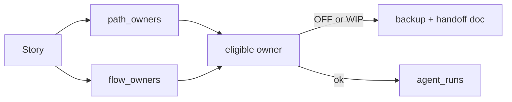
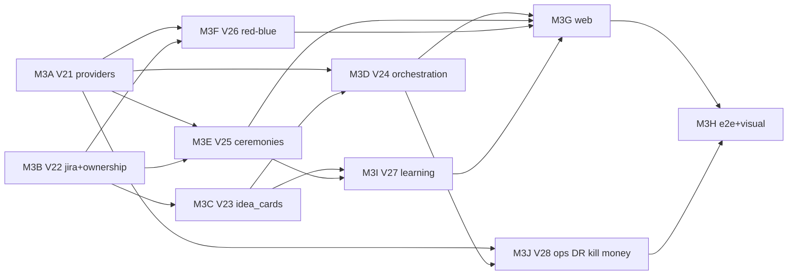

# Milestone 3 — Multi-provider coding company + real Jira workflow

Status: plan only (this PR). No feature code. Author: lead architect, 2026-10-27 (**rev 3** — owner decisions + PR #12 review must-fixes + persistent code ownership).
Inputs: `docs/PRODUCT_SPEC.md` (wins on conflict), `docs/milestones/M2_PLAN.md`, `docs/CURSOR_PROVIDER.md`, `PROGRESS.md`.
Base: `main` with M2 backend (#9) and M2 frontend (#11). PR #6 closed (JWT on main). Open #10 independent.

M3 turns the M2 Cursor-only coding pipeline into a **multi-provider** engineering company with a **Jira-like board**, **idea → proposal → approve** lifecycle, **persistent code/flow ownership** (CODEOWNERS-style path map from merged PRs), agent dependency contracts, scrum ceremonies, merge-order advice, `confluence/` docs, a **learning agent** (owner-approved skill/prompt updates), and a **full local red/blue** loop. Planning uses any `canPlan` provider; coding lists only `canCode` agents. Agents never merge. UI stays simple (#8/#11 primitives).

---

## 0. Decisions (owner-locked, 2026-10-27)

| # | Decision |
|---|---|
| 1 | **No product-default provider.** Setup: user picks and connects; that becomes the **project** default per tier. Changeable in Settings anytime. |
| 2 | **Capability-filtered lists.** Planning = any `canPlan` (incl. Ollama / OpenAI-compatible / Gemini). Coding = **only** `canCode` (Claude Code, Cursor, Codex, Antigravity). Non-coders are **omitted** from the coding list (never show-and-block). |
| 3 | Claude/Codex: **API key only**. Antigravity: `agy` + `GEMINI_API_KEY` (Gemini API for planning). Detect CLI binary; show install steps if missing; **never auto-install**. |
| 4 | Fibonacci `1,2,3,5,8,13`. Estimated days **ceil to next Fib** (`ceilFib`). Due date = points as working days (Sat/Sun off). `ceilFib` only when converting a day estimate → points; stored points remain 1 pt = 1 working day for schedule math (M2 unchanged). |
| 5 | UI mocks: HTML + PNG for **every** state (default, modals, empty, error, loading, click outcomes). |
| 6 | Sprint = **10** working days. |
| 7 | Standup time configurable; default **08:00** in project/user timezone. |
| 8 | Dependency verify is **hard**: requester A E2E-tests B before B → `awaiting_merge`. |
| 9 | Red/blue **full scope** in M3 against **local stack only** (see §11 lockdown). |
| 10 | Per-provider credential rows; **several labeled keys per provider**; **one active credential per tier** (planning, coding). |
| 11 | PR #6 closed. |
| 12 | **Persistent code ownership.** The agent that builds a flow/path **owns** it thereafter. Future stories that touch those paths route to that owner. Backup only if owner OFF, over WIP, or user reassigns. Handoff logged in `ticket_events` + handover doc. |

Config keys:

| Setting | Default |
|---|---|
| `ARIA_SPRINT_WORKDAYS` | `10` |
| `ARIA_STANDUP_TIME` | `08:00` |
| `ARIA_SECURITY_REVIEW` | `true` |
| `ARIA_RED_BLUE_ENABLED` | `true` |
| `ARIA_RED_BLUE_ALLOWLIST` | compose DNS + `localhost` + `ARIA_PUBLIC_URL` host |
| `ARIA_RED_BLUE_MAX_ROUNDS` | `3` |
| `ARIA_RED_BLUE_RATE_PER_HOUR` | `6` |
| `ARIA_AGENT_WIP_LIMIT` | `1` (active tickets counted; `awaiting_merge` excluded unless config flips) |
| `ARIA_QA_BROWSER` | `true` (evidence capture; middleware still never merges) |
| `ARIA_KILL_SWITCH` | `false` (global pause) |

---

## 1. Architect design locks

| # | Lock |
|---|---|
| D1 | Keep M2 `ReasoningModel` / `CodeWorker`; add `ProviderAdapter` registry + capabilities. |
| D2 | Active **credential id** per tier (not only provider id). Multi-key UX: add / list / test / activate / retire. |
| D3 | Test Connection (+ binary detect) hard gate before activate. Secrets `gcm:v2`; GET never returns ciphertext. |
| D4 | CI stubs for every adapter. |
| D5 | High tier = plan/design/split/ceremony/merge-order/security/ideas/learning proposals; low = code/tests/docs/mocks. |
| D6 | Jira: epic → story → sub_task; status `design` for mock pending. |
| D7 | UI mock gate: designer → PO+SM → owner approve/comment loop → develop. |
| D8 | Live Ideas path is **`idea_cards` + `feature_specs`** (not baseline `ideas`). M3 evolves `idea_cards`. |
| D9 | Hard dep verify; WIP=1 per agent enforced in dispatcher + unique running-run index. |
| D10 | **Path ownership** table (CODEOWNERS-like) updated on owner merge; dispatcher routes by path ∩ flow_owners. |
| D11 | Learning agent proposes versioned skill/prompt patches; **owner approves** before apply (no silent self-rewrite). |
| D12 | Extend `evidenceAllowsMerge` (do not fork) for DoD + security_review + dep verify. |
| D13 | Seed company roles must include **UI/UX designer**, **learning/coach**, **PR/merge coordinator**, red/blue, docs, research (ON/OFF by seat count as M1). |
| D14 | Simple UI; notifications for pending owner approvals. |
| D15 | Flyway: **strict contiguous versions per PR merge order** — no pre-claimed holes (§4, §14). |

Non-goals (runtime): multi-tenant SaaS, agents merging, GitHub webhooks, subscription OAuth for Claude/Codex, auto-install CLIs, silent learning self-rewrite.

---

## 2. Providers

### 2.1 Capability matrix → UI lists

| Provider | `canPlan` | `canCode` | Planning list | Coding list | Auth (M3) |
|---|---|---|---|---|---|
| Cursor | yes | yes | yes | yes | API key |
| Claude Code | yes | yes | yes | yes | `ANTHROPIC_API_KEY` |
| Codex | yes | yes | yes | yes | API key (`CODEX_API_KEY`) |
| Antigravity | yes | yes (`agy`) | yes | yes | `GEMINI_API_KEY` |
| Gemini / OpenAI / Anthropic chat | yes | no | yes | **omit** | API key |
| Ollama / openai_compatible / custom | yes | no* | yes | **omit*** | base URL ± key |

\*If adapter later sets `canCode=true`, it appears in coding automatically.

Sources (2026-10-27): [Claude headless](https://code.claude.com/docs/en/headless), [Codex exec](https://learn.chatgpt.com/docs/non-interactive-mode), [Antigravity headless](https://antigravity.google/docs/cli/headless/), [Ollama chat](https://docs.ollama.com/api/chat), `docs/CURSOR_PROVIDER.md`.

### 2.2 Multi-key UX (Decision 10)

- Many rows per `(workspace, provider)` distinguished by `label` (e.g. `personal`, `work`).
- `GET /providers` returns ids, labels, health, `last_tested_at`, binary status — **never** secrets.
- Activate for a tier stores `workspaces.active_planning_credential_id` / `active_coding_credential_id` (FK to credential row). Project may override with its own FKs.
- Retire: soft-delete / `retired_at`; cannot activate retired; last-ok credential can remain listed.
- Setup stepper: **both** tiers must have an activated credential (coding requires binary ok) before “Continue” — API `POST /setup/complete` returns 409 if missing.

### 2.3 Adapter sketch

```ts
providersForTier(tier: 'planning' | 'coding'): ProviderAdapter[]; // filters canPlan/canCode
```

CLI adapters implement the same `CodeWorker.follow/cancel/usage` shape as Cursor (poll/stream shim from CLI stdout).

---

## 3. Architecture (delta)

Dispatcher routing order for a story:

1. Explicit `assignee_agent_id` if set and agent eligible (ON, under WIP).
2. Else **path owners** for files the story declares / knowledge map predicts.
3. Else **flow_owners** (layer) for `tickets.flow_id`.
4. Else scrum-master assignment from `story_split`.
5. If primary owner OFF / at WIP → **backup** (flow or path); log `ownership_handoff` event + handover doc.
6. User reassign → same handoff path.



---

## 4. Data model — Flyway (strict order)

**Rule (must-fix #1):** Each implementation PR claims the **next free** `Vnn` at merge time. Planned numbers below assume merge order **A → B → C → D → E → F → …**. No PR “owns a later V while another owns an earlier.” Activity/runtime CHECKs are altered (DROP/ADD like V19) in the **first** PR that needs new values (M3A for provider runtimes; later PRs extend again when adding activities).

### V21 — M3A — providers + credentials

```sql
CREATE TABLE provider_credentials (
  id UUID PRIMARY KEY DEFAULT uuid_generate_v4(),
  workspace_id UUID NOT NULL REFERENCES workspaces(id) ON DELETE CASCADE,
  provider TEXT NOT NULL,
  label TEXT NOT NULL DEFAULT 'default',
  api_key_encrypted TEXT,
  base_url TEXT,
  extra_encrypted TEXT,
  connection_status TEXT NOT NULL DEFAULT 'untested'
    CHECK (connection_status IN ('untested','ok','failed')),
  last_tested_at TIMESTAMPTZ,
  last_error TEXT,
  binary_status TEXT NOT NULL DEFAULT 'not_required'
    CHECK (binary_status IN ('unknown','ok','missing','not_required')),
  retired_at TIMESTAMPTZ,
  catalog_json JSONB NOT NULL DEFAULT '[]'::jsonb,
  catalog_refreshed_at TIMESTAMPTZ,
  created_at TIMESTAMPTZ NOT NULL DEFAULT NOW(),
  updated_at TIMESTAMPTZ NOT NULL DEFAULT NOW(),
  UNIQUE (workspace_id, provider, label)
);

ALTER TABLE workspaces
  ADD COLUMN IF NOT EXISTS active_planning_credential_id UUID REFERENCES provider_credentials(id) ON DELETE SET NULL,
  ADD COLUMN IF NOT EXISTS active_coding_credential_id UUID REFERENCES provider_credentials(id) ON DELETE SET NULL;
ALTER TABLE projects
  ADD COLUMN IF NOT EXISTS planning_credential_id UUID REFERENCES provider_credentials(id) ON DELETE SET NULL,
  ADD COLUMN IF NOT EXISTS coding_credential_id UUID REFERENCES provider_credentials(id) ON DELETE SET NULL,
  ADD COLUMN IF NOT EXISTS timezone TEXT NOT NULL DEFAULT 'UTC',
  ADD COLUMN IF NOT EXISTS standup_time TEXT NOT NULL DEFAULT '08:00',
  ADD COLUMN IF NOT EXISTS sprint_workdays INTEGER NOT NULL DEFAULT 10;

-- runtime CHECK extend (V19 pattern)
ALTER TABLE agent_runs DROP CONSTRAINT IF EXISTS agent_runs_runtime_check;
ALTER TABLE agent_runs ADD CONSTRAINT agent_runs_runtime_check
  CHECK (runtime IN (
    'cursor_local','cursor_cloud','local_worktree','chat',
    'claude_cli','codex_cli','antigravity_cli'));
```

### V22 — M3B — Jira hierarchy, AC schema, ownership paths, event types

```sql
ALTER TABLE tickets
  ADD COLUMN IF NOT EXISTS issue_type TEXT NOT NULL DEFAULT 'story'
    CHECK (issue_type IN ('epic','story','sub_task')),
  ADD COLUMN IF NOT EXISTS parent_id UUID REFERENCES tickets(id) ON DELETE CASCADE,
  ADD COLUMN IF NOT EXISTS epic_id UUID REFERENCES tickets(id) ON DELETE SET NULL,
  ADD COLUMN IF NOT EXISTS acceptance_criteria JSONB NOT NULL DEFAULT '[]'::jsonb,
  -- Zod: [{ given: string, when: string, then: string }]  (min 1 for story/sub_task before ready)
  ADD COLUMN IF NOT EXISTS behaviour_notes TEXT,
  ADD COLUMN IF NOT EXISTS ui_affected BOOLEAN NOT NULL DEFAULT FALSE,
  ADD COLUMN IF NOT EXISTS ui_mock_status TEXT NOT NULL DEFAULT 'not_required'
    CHECK (ui_mock_status IN (
      'not_required','pending_designer','pending_po_sm','pending_owner',
      'changes_requested','approved')),
  ADD COLUMN IF NOT EXISTS api_contract JSONB,
  ADD COLUMN IF NOT EXISTS dor_checklist JSONB NOT NULL DEFAULT '[]'::jsonb,
  ADD COLUMN IF NOT EXISTS dod_checklist JSONB NOT NULL DEFAULT '[]'::jsonb,
  ADD COLUMN IF NOT EXISTS readiness_status TEXT NOT NULL DEFAULT 'not_ready'
    CHECK (readiness_status IN ('not_ready','ready','blocked')),
  ADD COLUMN IF NOT EXISTS rollback_plan TEXT,
  ADD COLUMN IF NOT EXISTS sprint_id UUID,
  ADD COLUMN IF NOT EXISTS assignee_agent_id UUID REFERENCES skills(id) ON DELETE SET NULL,
  ADD COLUMN IF NOT EXISTS predicted_paths JSONB NOT NULL DEFAULT '[]'::jsonb,
  ADD COLUMN IF NOT EXISTS idea_card_id UUID;  -- FK added in V23 with idea_cards evolution

CREATE TABLE ticket_links ( /* blocks|is_blocked_by|relates|contracts|duplicates + verify fields — as rev2 */ );
CREATE TABLE sprints (
  id UUID PRIMARY KEY DEFAULT uuid_generate_v4(),
  project_id UUID NOT NULL REFERENCES projects(id) ON DELETE CASCADE,
  name TEXT NOT NULL,
  goal TEXT,
  starts_on DATE NOT NULL,
  ends_on DATE NOT NULL,
  status TEXT NOT NULL DEFAULT 'planned'
    CHECK (status IN ('planned','active','closed')),
  created_at TIMESTAMPTZ NOT NULL DEFAULT NOW()
);
ALTER TABLE tickets ADD CONSTRAINT tickets_sprint_fk
  FOREIGN KEY (sprint_id) REFERENCES sprints(id) ON DELETE SET NULL;

CREATE TABLE ticket_comments ( /* owner|agent|system */ );
CREATE TABLE ticket_attachments (
  /* kind incl ui_mock_html|ui_mock_png|interaction_png; state_key required for mocks */
);

-- Persistent path ownership (CODEOWNERS-like)
CREATE TABLE path_owners (
  id UUID PRIMARY KEY DEFAULT uuid_generate_v4(),
  project_id UUID NOT NULL REFERENCES projects(id) ON DELETE CASCADE,
  path_glob TEXT NOT NULL,              -- e.g. 'apps/web/src/app/(auth)/**'
  layer TEXT NOT NULL CHECK (layer IN ('frontend','backend','fullstack','docs','other')),
  owner_agent_id UUID NOT NULL REFERENCES skills(id) ON DELETE RESTRICT,
  backup_agent_id UUID REFERENCES skills(id) ON DELETE SET NULL,
  source TEXT NOT NULL DEFAULT 'merged_pr'
    CHECK (source IN ('merged_pr','manual','flow_seed')),
  last_ticket_id UUID REFERENCES tickets(id) ON DELETE SET NULL,
  last_pr_number INTEGER,
  created_at TIMESTAMPTZ NOT NULL DEFAULT NOW(),
  updated_at TIMESTAMPTZ NOT NULL DEFAULT NOW(),
  UNIQUE (project_id, path_glob, layer)
);
CREATE INDEX path_owners_owner_idx ON path_owners(owner_agent_id);

CREATE TABLE ownership_handoffs (
  id UUID PRIMARY KEY DEFAULT uuid_generate_v4(),
  project_id UUID NOT NULL REFERENCES projects(id) ON DELETE CASCADE,
  path_owner_id UUID REFERENCES path_owners(id) ON DELETE SET NULL,
  flow_id UUID REFERENCES business_flows(id) ON DELETE SET NULL,
  from_agent_id UUID REFERENCES skills(id) ON DELETE SET NULL,
  to_agent_id UUID NOT NULL REFERENCES skills(id) ON DELETE RESTRICT,
  reason TEXT NOT NULL CHECK (reason IN ('owner_off','wip_exceeded','user_reassign','agent_deleted')),
  handover_md TEXT NOT NULL,
  ticket_id UUID REFERENCES tickets(id) ON DELETE SET NULL,
  created_at TIMESTAMPTZ NOT NULL DEFAULT NOW()
);

-- Extend ticket_events.event_type (V17/V19 DROP/ADD pattern)
ALTER TABLE ticket_events DROP CONSTRAINT IF EXISTS ticket_events_event_type_check;
ALTER TABLE ticket_events ADD CONSTRAINT ticket_events_event_type_check
  CHECK (event_type IN (
    'status_change','agent_action','progress','communication','run_ref',
    'owner_decision','schedule','evidence',
    'mock_review','dep_verify','ceremony_ref','security_finding',
    'agent_message','ownership_handoff','learning_proposal','readiness'));
```

Given/When/Then Zod (shared):

```ts
const acceptanceCriterionZ = z.object({
  given: z.string().min(1).max(2000),
  when: z.string().min(1).max(2000),
  then: z.string().min(1).max(2000),
});
const acceptanceCriteriaZ = z.array(acceptanceCriterionZ).min(1);
```

### V23 — M3C — idea_cards lifecycle (must-fix #2/#3)

**Canonical table: `idea_cards`.** Baseline `ideas` / old `feature_specs.idea_id` remain for Hibernate compat where needed; middleware Ideas API already uses `idea_cards` — extend that path. Do **not** build §6 on baseline `ideas`.

```sql
-- Backfill BEFORE tighter CHECKs (must-fix #3)
UPDATE idea_cards SET status = 'researching'
  WHERE status IN ('draft','ready_for_review');
UPDATE idea_cards SET status = 'approved' WHERE status = 'approved'; -- no-op keep
UPDATE idea_cards SET status = 'declined'
  WHERE status IN ('rejected');
UPDATE idea_cards SET status = 'planning'
  WHERE status = 'in_development';

ALTER TABLE idea_cards
  ADD COLUMN IF NOT EXISTS idea_key TEXT,
  ADD COLUMN IF NOT EXISTS current_version INTEGER NOT NULL DEFAULT 0,
  ADD COLUMN IF NOT EXISTS metrics_json JSONB NOT NULL DEFAULT '{}'::jsonb,
  ADD COLUMN IF NOT EXISTS cost_json JSONB,
  ADD COLUMN IF NOT EXISTS risks_json JSONB NOT NULL DEFAULT '[]'::jsonb,
  ADD COLUMN IF NOT EXISTS source TEXT NOT NULL DEFAULT 'research_agent';

-- Replace status constraint carefully: drop enum/check → set default → add check
-- (idea_cards.status is TEXT with idea_status enum in Drizzle; migration aligns TEXT CHECK)
ALTER TABLE idea_cards ALTER COLUMN status SET DEFAULT 'researching';
-- After backfill:
-- CHECK (status IN ('researching','proposal_draft','agent_review','awaiting_owner',
--   'revising','approved','declined','planning','done'))

CREATE UNIQUE INDEX idea_cards_project_key_uidx ON idea_cards(project_id, idea_key);

CREATE TABLE idea_versions (
  id UUID PRIMARY KEY DEFAULT uuid_generate_v4(),
  idea_card_id UUID NOT NULL REFERENCES idea_cards(id) ON DELETE CASCADE,
  version INTEGER NOT NULL,
  title TEXT NOT NULL,
  body_md TEXT NOT NULL,
  path_in_repo TEXT,
  content_hash TEXT NOT NULL,
  diff_from_prev TEXT,
  created_by_agent_id UUID REFERENCES skills(id) ON DELETE SET NULL,
  created_at TIMESTAMPTZ NOT NULL DEFAULT NOW(),
  UNIQUE (idea_card_id, version)
);

CREATE TABLE idea_comments ( /* same shape as rev2; FK idea_card_id */ );

CREATE TABLE idea_events (
  /* hash-chain mirror of ticket_events; UPDATE/DELETE raise; UNIQUE(idea_card_id, seq) */
);

ALTER TABLE tickets
  ADD CONSTRAINT tickets_idea_card_fk
  FOREIGN KEY (idea_card_id) REFERENCES idea_cards(id) ON DELETE SET NULL;

-- feature_specs: prefer idea_card_id (already exists); stop writing baseline ideas.id for new work
```

`idea_id` column naming on tickets is **`idea_card_id` only**, added nullable in V22, FK in V23 (M3C depends on M3B).

### V24 — M3D — activities used by orchestration (+ learning)

```sql
ALTER TABLE agent_runs DROP CONSTRAINT IF EXISTS agent_runs_activity_check;
ALTER TABLE agent_runs ADD CONSTRAINT agent_runs_activity_check
  CHECK (activity IN (
    'knowledge_map','company_generation','develop','review','fix','qa','story_points',
    'docs_write','story_split','ui_mock','dep_request','dep_verify','implementation_design',
    'idea_research','idea_revise','idea_agent_review','readiness_check','contract_test',
    'learning_propose','sub_story_create'));
```

### V25 — M3E — ceremonies, merge-order, notifications (full DDL)

```sql
CREATE TABLE ceremony_sessions (
  id UUID PRIMARY KEY DEFAULT uuid_generate_v4(),
  workspace_id UUID NOT NULL REFERENCES workspaces(id) ON DELETE CASCADE,
  project_id UUID NOT NULL REFERENCES projects(id) ON DELETE CASCADE,
  kind TEXT NOT NULL CHECK (kind IN ('standup','planning','retro','strategy')),
  status TEXT NOT NULL DEFAULT 'queued'
    CHECK (status IN ('queued','running','succeeded','failed','cancelled')),
  scheduled_for TIMESTAMPTZ NOT NULL,
  agent_run_id UUID REFERENCES agent_runs(id) ON DELETE SET NULL,
  transcript_md TEXT,
  created_at TIMESTAMPTZ NOT NULL DEFAULT NOW(),
  finished_at TIMESTAMPTZ
);
CREATE INDEX ceremony_sessions_project_idx ON ceremony_sessions(project_id, scheduled_for DESC);

CREATE TABLE ceremony_messages (
  id UUID PRIMARY KEY DEFAULT uuid_generate_v4(),
  session_id UUID NOT NULL REFERENCES ceremony_sessions(id) ON DELETE CASCADE,
  seq INTEGER NOT NULL,
  speaker_agent_id UUID REFERENCES skills(id) ON DELETE SET NULL,
  role TEXT NOT NULL CHECK (role IN ('scrum_master','agent','system')),
  body TEXT NOT NULL,
  created_at TIMESTAMPTZ NOT NULL DEFAULT NOW(),
  UNIQUE (session_id, seq)
);

CREATE TABLE merge_order_snapshots (
  id UUID PRIMARY KEY DEFAULT uuid_generate_v4(),
  project_id UUID NOT NULL REFERENCES projects(id) ON DELETE CASCADE,
  agent_run_id UUID REFERENCES agent_runs(id) ON DELETE SET NULL,
  advice_json JSONB NOT NULL,
  created_at TIMESTAMPTZ NOT NULL DEFAULT NOW()
);

CREATE TABLE user_notifications (
  id UUID PRIMARY KEY DEFAULT uuid_generate_v4(),
  workspace_id UUID NOT NULL REFERENCES workspaces(id) ON DELETE CASCADE,
  project_id UUID REFERENCES projects(id) ON DELETE CASCADE,
  kind TEXT NOT NULL CHECK (kind IN (
    'idea_awaiting_owner','mock_awaiting_owner','approval_comment_reply',
    'schedule_at_risk','schedule_overdue','security_finding','ceremony_ready',
    'learning_proposal','kill_switch','provider_unhealthy')),
  title TEXT NOT NULL,
  href TEXT,
  payload JSONB NOT NULL DEFAULT '{}'::jsonb,
  read_at TIMESTAMPTZ,
  created_at TIMESTAMPTZ NOT NULL DEFAULT NOW()
);
```

Also extend activity CHECK for `ceremony`,`merge_order`,`release_notes` in this PR.

### V26 — M3F — red/blue + security_review activities + findings

```sql
-- activity add: security_review, red_team_attack, blue_team_fix
CREATE TABLE security_findings (
  id UUID PRIMARY KEY DEFAULT uuid_generate_v4(),
  project_id UUID NOT NULL REFERENCES projects(id) ON DELETE CASCADE,
  ticket_id UUID REFERENCES tickets(id) ON DELETE SET NULL,
  run_id UUID REFERENCES agent_runs(id) ON DELETE SET NULL,
  class TEXT NOT NULL,  -- auth_bypass|idor|injection|xss|ssrf|secrets_leak|prompt_injection|other
  severity TEXT NOT NULL CHECK (severity IN ('low','medium','high','critical')),
  title TEXT NOT NULL,
  detail_md TEXT NOT NULL,
  target_url TEXT NOT NULL,       -- must match allowlist host
  redacted BOOLEAN NOT NULL DEFAULT TRUE,
  created_at TIMESTAMPTZ NOT NULL DEFAULT NOW()
);
```

### V27 — M3I — learning proposals (can ship after M3E; see DAG)

```sql
CREATE TABLE learning_proposals (
  id UUID PRIMARY KEY DEFAULT uuid_generate_v4(),
  workspace_id UUID NOT NULL REFERENCES workspaces(id) ON DELETE CASCADE,
  project_id UUID NOT NULL REFERENCES projects(id) ON DELETE CASCADE,
  agent_id UUID REFERENCES skills(id) ON DELETE SET NULL,  -- target skill; null = shared EXPERIENCE
  version INTEGER NOT NULL,
  title TEXT NOT NULL,
  rationale_md TEXT NOT NULL,          -- from retros/failures; token-minimal
  patch_md TEXT NOT NULL,             -- proposed SKILL.md / instructions / experience.yml diff
  sources_json JSONB NOT NULL DEFAULT '[]'::jsonb,  -- ceremony ids, ticket ids
  status TEXT NOT NULL DEFAULT 'pending_owner'
    CHECK (status IN ('pending_owner','approved','rejected','applied')),
  created_at TIMESTAMPTZ NOT NULL DEFAULT NOW(),
  decided_at TIMESTAMPTZ,
  UNIQUE (project_id, agent_id, version)
);
```

### V28 — M3J (ops slice) — kill switch, money budget, audit export metadata

```sql
ALTER TABLE workspaces
  ADD COLUMN IF NOT EXISTS kill_switch BOOLEAN NOT NULL DEFAULT FALSE,
  ADD COLUMN IF NOT EXISTS kill_switch_reason TEXT,
  ADD COLUMN IF NOT EXISTS monthly_spend_cap_usd NUMERIC(12,2),
  ADD COLUMN IF NOT EXISTS spend_month_usd NUMERIC(12,2) NOT NULL DEFAULT 0;

CREATE TABLE audit_exports (
  id UUID PRIMARY KEY DEFAULT uuid_generate_v4(),
  workspace_id UUID NOT NULL REFERENCES workspaces(id) ON DELETE CASCADE,
  kind TEXT NOT NULL CHECK (kind IN ('ticket_events','idea_events','full_proof_pack')),
  sha256 TEXT NOT NULL,
  bytes BYTEA,                       -- or path in ARIA_DATA_DIR for large packs
  created_at TIMESTAMPTZ NOT NULL DEFAULT NOW()
);
```

---

## 5. Persistent code ownership (Decision 12)

### 5.1 Rules

1. On **owner merge** of an agent PR (`prWatcher` merged path): compute changed paths; upsert `path_owners` for globs derived from top-level dirs / flow entrypoints (deterministic mapper); set `owner_agent_id` = developing agent; preserve existing owner if same agent; if different agent wrote in owned path without handoff → still record but flag `communication` for scrum master (should have been routed correctly).
2. Also update `flow_owners` when the ticket has `flow_id` (builder becomes owner for that layer if vacant or same lineage).
3. **Routing** — see §3. Path match uses longest-prefix / most specific glob wins.
4. **Backup takeover** when owner `status=off` OR active WIP ≥ `ARIA_AGENT_WIP_LIMIT` OR user reassign.
5. **Handoff:** write `ownership_handoffs.handover_md` (what/why/where/open risks), append `ticket_events` type `ownership_handoff`, store under `confluence/ownership/...` via docs allowlist optional.
6. **UI:** flow detail and story card/detail show **Owner** + **Backup**; path list on Company → Ownership tab (simple table).

### 5.2 API

| Method | Path |
|---|---|
| `GET` | `/api/projects/:id/path-owners` |
| `POST` | `/api/projects/:id/path-owners/reassign` (owner only) |
| `GET` | `/api/tickets/:id` includes resolved `ownerAgent`, `backupAgent`, `ownershipSource` |

### 5.3 Tests

- Merge stub PR → path_owners rows for touched globs.
- Next ticket with those predicted_paths assigns same owner.
- Owner OFF → backup + handoff event + handover_md.
- WIP=1: second ticket stays queued / assigned backup only if policy says so (default: stay unassigned until WIP frees — backup only for OFF/reassign; **overload uses backup** per owner Decision 12).
- User reassign logged.

---

## 6. Idea lifecycle (on `idea_cards`)

Same state machine as rev2 (`researching` → … → `approved`/`declined`), but all FKs point at **`idea_cards`**. APIs keep `/api/projects/:id/ideas` mapping to `idea_cards`. Versioned proposals, CEO/CFO comments, owner Approve/Decline/Comment loop, research replies with evidence, then PO+SM+devs `story_split`, UI mock gate, FE/BE `api_contract`, click-by-click + persistence evidence, all events on `idea_events` / `ticket_events`.

**Status backfill:** `draft|ready_for_review` → `researching`; `rejected` → `declined`; `in_development` → `planning`; default column → `researching` **before** CHECK (must-fix #3).

**Keys:** `UNIQUE(project_id, idea_key)` not global.

**Telemetry source for research:** knowledge map + ticket outcomes + local app metrics table if present; scheduled `idea_research` + standing “AI opportunity” job weekly (minimal tokens).

---

## 7. Learning agent (M3 slice — was MISSING)

- Role seeded: `learning_coach` (OFF if seats full).
- Inputs: retro transcripts, failed runs, QA/security findings (ids only + short digests).
- Output: `learning_proposals` versioned patch (SKILL.md / agent instructions / `.entiresystem/EXPERIENCE` entry).
- **Owner Approve/Reject** in simple UI; on approve, apply patch + FIM re-sign if needed; event `learning_proposal`.
- Token budget: one planning call per proposal; no full-repo rewrite.
- Tests: propose → pending; approve applies; reject leaves skills unchanged; GET never exposes unrelated secrets.

---

## 8. Company extras + visual regression

| Extra | M3 behavior |
|---|---|
| DoR / DoD / readiness | Gates before develop / awaiting_merge |
| G/W/T AC schema | Zod above; story_split must emit ≥1 |
| `sub_story_create` activity | Agents may create sub_tasks under a story |
| WIP=1 | Dispatcher + count of non-terminal assigned tickets (excl. awaiting_merge by default) |
| Seed roles | UI/UX designer, learning, PR coordinator, red, blue, docs, research |
| FE↔BE contract + contract_test | Required when both layers |
| Interaction evidence | state_key steps in evidence |
| **Visual regression** | M3H: Playwright screenshot baselines for web shell critical routes + story mock state_keys; plus pixel/hash compare helper used by QA gate when `ui_affected` |
| QA prev-vs-current baseline | Store last-approved report screenshots hashed on ticket; QA must reference baseline ids |
| Notifications | Pending approvals, overdue, learning, security, provider unhealthy |
| Release notes / rollback | On sprint close / before coding |

`evidenceAllowsMerge(ticketId, headSha)` **extended** in M3D/F to also require: DoD checklist complete, `security_review` succeeded (if flag), all `contracts` links `verified_at` set, readiness was `ready`. Single function — no fork.

---

## 9. Red/blue lockdown (must-fix #4)

| Rule | Detail |
|---|---|
| Kill | `ARIA_RED_BLUE_ENABLED=false` or workspace `kill_switch` → no enqueue / cancel running red runs |
| Egress | Deny-by-default. Resolver allows only hosts in `ARIA_RED_BLUE_ALLOWLIST` (compose service names, `127.0.0.1`, `localhost`, `ARIA_PUBLIC_URL` host). **No public DNS** for attack tools. |
| SSRF class | Finding against **app** accepting attacker-controlled URLs; harness itself never fetches non-allowlisted URLs |
| Secrets | Red-team runtime env **strips** provider credentials, GitHub tokens, JWT keys, `WORKSPACE_ENCRYPTION_KEY`. Findings scrubbed with existing log redaction before ticket insert |
| Rate | `ARIA_RED_BLUE_RATE_PER_HOUR`; round cap `ARIA_RED_BLUE_MAX_ROUNDS` |
| DB | Attacks use disposable compose profile `redteam` DB when available; never drop owner primary volume |
| Tests | Unit: allowlist reject `evil.com`; integration: stub run without creds in env; finding ticket has no `gcm:` ciphertext |

---

## 10. API / UI / gates (summary)

Providers multi-key activate; Ideas on idea_cards; board/sprint/story; path ownership; learning proposals; notifications; kill switch; merge-order; ceremonies; security findings — all Zod + IDOR.

**Setup:** project create picks planning + coding credentials (filtered lists); Test Connection required; coding binary required; then continue.

**Gates:** Test Connection; canCode list omit; idea approve; mock approve; DoR; contract; dep verify; DoD+evidence+security; ownership handoff logged; merge tripwire; red egress; kill switch.

---

## 11. Token minimization

Unchanged spirit §12 rev2 + learning proposals batched; ownership mapper is deterministic (zero LLM); research uses digests not raw logs.

---

## 12. Test plan (strengthened)

**Unit:** `providersForTier` omits !canCode; multi-key activate; ceilFib vs due-date (1 pt = 1 day); G/W/T Zod; WIP=1; path glob specificity; handoff reasons; red allowlist; learning patch apply; idea status backfill map; GET serializers strip secrets.

**Integration:** credential encrypt; idea_cards version loop + idea_events UPDATE/DELETE raise; approve→tickets with `idea_card_id`; mock gate; `evidenceAllowsMerge` new conjuncts; path_owners after merge; backup on OFF; kill_switch blocks queue; red run env has no API keys.

**Playwright ×3:** multi-key Settings; filtered coding list; Setup blocks without coding activate; Ideas comment loop; ownership shown on story; learning approve; visual regression baselines; notifications; kill switch banner.

**Anti-test-dodging** on all new specs.

---

## 13. PR split — executable DAG (post must-fix)



| PR | Flyway | Scope | Depends | Parallel |
|---|---|---|---|---|
| **M3A** | V21 | Credentials multi-key, adapters, stubs, Test Connection, setup gate, runtime CHECK | main | **M3B** only |
| **M3B** | V22 | Hierarchy, G/W/T, sprints 10d, path_owners, handoffs, ticket_events types, WIP helpers | main | **M3A** |
| **M3C** | V23 | **idea_cards** lifecycle, versions, comments, events, status backfill, `tickets.idea_card_id` FK | **M3B** | after B; ∥ D’s prep only after C |
| **M3D** | V24 | docs/split/mock/dep_verify/readiness/sub_story; extend `evidenceAllowsMerge`; ownership routing in dispatcher | M3A+C | **M3E**, **M3F** |
| **M3E** | V25 | Full ceremony/merge-order/notifications DDL+runners; standup→events | M3A+B | **M3D**, **M3F** |
| **M3F** | V26 | Red/blue lockdown + security_review + findings | M3A+B | **M3D**, **M3E** |
| **M3I** | V27 | Learning proposals + owner approve apply | M3C+E | **M3J**, after D preferred |
| **M3J** | V28 | Kill switch, $ caps, audit export, backup docs script | M3A+D | **M3I** |
| **M3G** | — | Simple UI for all of the above + ownership + learning | D+E+F+I | after those |
| **M3H** | — | Playwright + visual regression + PROVIDERS.md + PROGRESS | M3G+J | last |

**Not parallel:** M3C with M3B. **Not** “A owns V24 while E owns V23.”

---

## 14. Ranked gaps (owner-unmentioned) — slice or Later

| Rank | Gap | Disposition |
|---|---|---|
| 1 | DR/backup + audit export of proof chains | **M3J** — `audit_exports`, `scripts/aria-backup.sh` (Postgres dump + `.entiresystem` + key material instructions); restore runbook in docs; tests: export hash stable, foreign workspace 404 |
| 2 | Global kill switch / pause all / freeze red-team / owner-away | **M3J** — `workspaces.kill_switch`; API + Settings toggle; worker refuses new claims; tests |
| 3 | Eval harness for agent quality | **M3H** minimal: golden fixture tickets scored in vitest against stubs (develop/idea_revise JSON schema pass rate). Fuller SWE-bench gate → **Later (M4 / Sprint 14)** |
| 4 | Money budgets ($ caps) + CFO dashboard | **M3J** — `monthly_spend_cap_usd` + provider price table config; hard stop + notify; simple Settings field (not a finance product). Full Stripe/procurement → **Later** |
| 5 | Memory/learning loop | **M3I** (this milestone) |
| 6 | Environment matrix / redteam DB profile | **M3F** — compose profile `redteam` + reset script; full stage/prod matrix → **Later** |
| 7 | Incident / on-call path | **Later** — Sprint 9 incident commander exists unverified; wire UI in M4 |
| 8 | Supply-chain / dependency policy | **M3D** light: `diffGuards` reject new deps without `owner_decision` ack flag on ticket; fuller license allowlist → **Later** |
| 9 | a11y / i18n bars | **Later** — add AC template examples in docs only in M3; gates in M4 |
| 10 | Multi-repo merge-order | **M3E** — advice groups by repoUrl; true cross-repo stacking → **Later** |
| 11 | Provider outage failover | **M3A/J** — unhealthy active credential → notify + pause coding queue (no silent poison); auto-failover to second labeled key if `ok` → M3A |
| 12 | PII redaction in events/confluence | **M3D** — run Sanitizer + PII scrubber on event summary/detail and docs_write; tests with fake email/PAN |

---

## 15. Requirements traceability

| # | Owner requirement | Plan section | PR | Test |
|---|---|---|---|---|
| 1 | Signup | PRIOR M1 | — | existing auth e2e |
| 2 | Create project | PRIOR + §2.2 setup credentials | M3A/G | setup blocks without tier activate |
| 3 | Connect+test providers | §0 D1–3, §2 | M3A/G | Test Connection; binary missing |
| 4 | Several keys per provider | §0 D10, §2.2 | M3A/G | multi-label activate/retire |
| 5 | Capability-filtered tiers | §0 D2, §2.1 | M3A/G | coding list omits Ollama |
| 6 | Knowledge map | PRIOR M1/M2 | — | — |
| 7 | Full company roles incl. designer/learning/PR coord | §1 D13 | M3D seed | company fixture includes roles |
| 8 | Org chart edit | PRIOR | — | — |
| 9 | Agents ON/OFF | PRIOR + ownership backup | M3B/D | OFF → handoff |
| 10 | Flow ownership + workers/backups | PRIOR flow_owners + §5 path_owners | M3B/D | path+flow routing |
| 11 | One task / deps | §0 D8, WIP=1 | M3B/D | WIP second ticket |
| 12 | Requester E2E verify | §0 D8, gates | M3D | verify gate |
| 13 | User merges only | PRIOR tripwire | — | stub violations 0 |
| 14 | Merge-order coordinator | §13 M3E | M3E/G | advice order fixture |
| 15 | Standups 08:00 + planning/retro | §0 D7, V25 | M3E/G | ceremony transcript |
| 16 | 10-day sprints | §0 D6 | M3B | sprint end date |
| 17 | Fib points + deadlines | §0 D4 ceilFib | M3B | ceilFib + due_at |
| 18 | Epics/stories/subtasks + G/W/T | V22 schema | M3B/D | Zod AC; sub_story_create |
| 19 | UI mocks HTML+PNG all states | §0 D5 | M3D/G | state_key completeness |
| 20 | FE/BE API contract | §8 | M3D | contract required |
| 21 | Dev/QA md+pdf gate | PRIOR + evidenceAllowsMerge extend | M3D/F | gate conjuncts |
| 22 | FE click-by-click evidence | §8 | M3D/H | evidence section |
| 23 | Tamper-evident logs | PRIOR + new event types | M3B/C | chain verify; UPDATE raises |
| 24 | Idea lifecycle | §6 on idea_cards | M3C/G | comment→version |
| 25 | Docs → confluence/ | docs_write | M3D | path allowlist |
| 26 | Red/blue | §9 | M3F | egress deny; no secrets in env |
| 27 | Learning agent | §7 | M3I/G | propose/approve/apply |
| 28 | Standing AI opportunity mission | §6 weekly idea_research | M3C/D | scheduled enqueue |
| 29 | Exhaustive UI/regression | §8 visual regression | M3H | baselines ×3 viewports |
| 30 | Minimal tokens | §11 | all | budget tests reuse M2 |
| 31 | Simple UI | §1 D14 | M3G | anti-slop |
| 32 | Single user local-first | non-goals | — | — |
| 33 | **Persistent code ownership** | §0 D12, §5 | M3B/D/G | merge→route→handoff |

---

## 16. Risks

| Risk | Mitigation |
|---|---|
| Flyway out-of-order | Contiguous Vnn by merge DAG (§13) |
| idea_cards vs ideas fork | §6 / V23 canonical idea_cards |
| Red exfil | §9 deny-by-default + stripped env |
| Ownership thrash | Longest glob wins; handoff required for reassign |
| Learning bad patches | Owner approve; versioned; reject path |

---

## 17. Later (explicit deferrals)

- Full chaos sandbox / WebArena / SWE-bench Verified weekly (Sprint 14)
- Multi-tenant SaaS; GitHub webhooks
- Subscription OAuth for Claude/Codex
- Auto CLI install
- Silent skill self-rewrite without owner
- Full FinOps/Stripe procurement
- a11y/i18n hard gates
- Cross-repo stacked PRs
- Incident Commander UI polish (code exists Sprint 9 unverified)
- Worker pools under flow owners beyond backup

---

## 18. Definition of Done (M3)

- [ ] M3A–J, G, H merged in DAG order with contiguous Flyway
- [ ] Multi-key providers; capability-filtered lists; setup gates
- [ ] idea_cards lifecycle + backfill; no ideas-table fork
- [ ] Persistent path+flow ownership with handoff + UI
- [ ] WIP=1; G/W/T; mocks; dep verify; extended evidenceAllowsMerge
- [ ] Learning proposals owner-approved
- [ ] Red/blue lockdown proven by tests
- [ ] Kill switch, audit export, $ cap basics (M3J)
- [ ] Visual regression + Playwright ×3; anti-test-dodging clean
- [ ] Traceability rows 1–33 satisfied or explicitly Later
- [ ] Agents never merge
